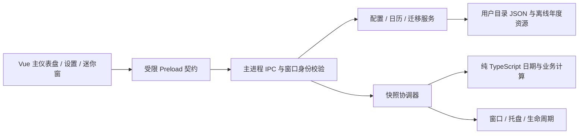

# V2.0.0 技术架构与数据设计

状态：2026-10-13已实施D02的共享类型、结构校验和纯草稿辅助；运行服务、正式业务计算、IPC/Preload接入和UI仍未实施。Q01–Q12事实唯一来源为 [REQUIREMENTS](V2.0.0_REQUIREMENTS.md)；本轮仅D02获授权，D03–D18未授权。任务入口见 [TASKS](V2.0.0_TASKS.md)。

## 分层与依赖方向



- `domain/` 不导入 Electron、Vue、文件系统或全局定时器；显式接收时钟、配置、日历和已确认策略，返回数据或结构化错误。所有业务分支可固定时间测试。
- main 管理 I/O、原生窗口、托盘、单实例和权威配置；renderer 不直接访问 Node 或文件路径，不独立计算另一套业务结果。
- `shared/` 只有类型、IPC DTO、纯验证辅助；domain 可在 main 中调用，renderer 仅消费快照类型。Vue 动画不修改业务进度。
- 不新增 HTTP 服务、数据库、持久后台服务或应用联网下载逻辑。现有 electron-vite dev server 仅用于开发。

## 拟定目录

下列为完整目标目录：D02只创建shared契约/校验/能力/草稿模块及对应单元测试；其余服务/domain/UI/年度资源仍为规划，不已实现。旧settings.ts仅type-only复用LocalTime，保留POC运行契约。

```text
desktop/src/
  main/
    index.ts                       # 启动顺序和依赖装配
    ipc/router.ts                  # 固定 handler、窗口/框架鉴权、错误 DTO
    services/config-store.ts       # 排队写入、校验、备份、版本及 revision
    services/calendar-store.ts     # 内置年度 + 用户年度包 + 日期覆盖
    services/migration-service.ts  # 只读探测、预览、明确提交
    services/snapshot-service.ts   # 时钟、缓存、窗口订阅与状态快照
    services/clock.ts              # wall clock、resume、时区/日期变化检测
    windows/window-manager.ts      # 主窗、迷你窗、位置恢复、身份登记
    windows/tray-manager.ts        # 常驻引用、菜单、恢复及 tooltip
    lifecycle/single-instance.ts   # 同一用户目录单实例
    lifecycle/quit-coordinator.ts  # 后续：显式退出、落盘及清理
  preload/index.ts                 # 一个自包含 CJS 文件，类型化 API
  shared/contracts.ts             # D02：Config / Snapshot / Result / API / Draft
  shared/validation.ts            # D02：安全JSON边界、纯结构验证原语
  shared/config-schema.ts         # D02：配置/可编辑字段/基础格式验证
  shared/capabilities.ts          # D02：固定请求DTO、窗口能力表、revision比较
  shared/settings-draft.ts        # D02：隔离草稿/保存状态辅助，无IO
  shared/settings.ts              # POC兼容层，运行行为保留至后续适配
  domain/
    local-date.ts                  # civil date、月份、闰年与安全时间解析
    calendar.ts                    # 覆盖优先级、来源、置信度、有界搜索
    employment.ts                  # 在职自然日、累计计划工作日
    schedule.ts                    # 当前/上一日班次、工作/休息区间
    salary.ts                      # 名义日期、调整、跨周期实际日期候选
    overtime.ts                    # shiftDate 归属、有效性、冲突
    progress.ts                    # 区间交集时长和 0–100% 进度
    dashboard.ts                   # 唯一业务快照组合
  renderer/src/
    App.vue
    views/DashboardView.vue
    views/SettingsView.vue
    views/MiniView.vue
    components/{MetricCard,CountdownCard,FishProgress,StatusBadge}.vue
    settings/{ScheduleSettings,SalarySettings,OvertimeSettings,
              AppearanceSettings,DesktopSettings,DataSettings,CalendarSettings}.vue
    composables/{useSnapshot,useSettingsDraft,useTheme,useMotion}.ts
    styles/{tokens,base}.css
desktop/resources/calendar/{manifest,2024,2025,2026}.json
desktop/packaging/                 # 后续原生图标等打包资源
desktop/tests/{unit,desktop,fixtures}/
```

沿用 POC 脚本作为回归基线；拆分测试时保证原有覆盖不丢失。只在有测量依据时引入轻量库；当前优先原生 API 和 Vue composable，不预设 Pinia、日期库或 schema 大依赖。

## 业务输入、状态与快照

建议 DTO：`DashboardSnapshot` 包含 `sequence`、`computedAt`、`localDate`、`timeZoneId`、`configRevision`、`calendarRevision`、`state`、`activeShift`、`employment`、`nextRest`、`salary`、`countdown`、`progress`、`warnings`。日期使用 `YYYY-MM-DD`，时间使用 `HH:MM`，瞬时点用毫秒 epoch；不能混用 civil date 与 UTC timestamp。

业务 `state` 为 `rest | beforeWork | working | break | overtime | finished | incomplete`。先找仍有效的先前开始班次，再查今日排班；基础跨度上限24小时加600分钟可能跨两个日期边界，不能只检查昨日。休息日不盖掉有效跨日班次。按 Q03 上班前目标为开始时刻，班中目标为最终下班；Q04 禁止活动班次重叠。函数显式接收已确认 `BusinessPolicies`，不在内部另选默认值。

主窗、迷你窗、托盘使用同一 `sequence` / revision 快照；两窗互斥可见也需一致状态。午休冻结有效工作进度，墙上时钟倒计时继续减少。净进度排除午休并包含当前班次加班，变更后允许回退；无班次用 null/无进度，不能返回貌似正确的0。

日历判定携带 `source`、`annualVerification`、`approximate` 和涉及年份，按 Q06 传播到休息/发薪/班次及依赖它们的输出。用户日期覆盖明确标为自定义；缺年周规则回退标估算/不完整。累计计划工作日始终标按当前规则推算，缺年另加覆盖不足提示；自然日差独立，不受年度缺失影响。年度包来源/版本字段不等于已完成官方核验，D04核验2024/2025后才允许对应官方核验标记。

日期差使用 civil date 序数；时刻适配器跟随系统本地时间/时区（Q12），跨夜使用明确下一 civil date；resume、时钟/时区/日期变化立即重算。沿用原设计对 DST 缺失/重复时刻返回明确校验错误/歧义，不能自动选未约定的偏移或静默归一化，不新增固定时区选择功能。

## 配置与数据结构

正式目录建议 `%APPDATA%\Workday Escape\`，与 `%APPDATA%\Workday Escape POC\` 和旧 EXE 旁 `config.json` 分离。迁移来源只读。正式 app 名称/appId 固定，不能因 EXE 位置、临时解压目录或补丁版本改变而产生新配置和第二实例。

| 组 | 拟定字段 | 约束与目的 |
| --- | --- | --- |
| 元数据 | `schemaVersion: 2`、`revision`、`updatedAt`、`appVersion` | schema 与产品版本分开；同一写入成功才递增 revision |
| employee | `startDate: LocalDate \| null` | 未设置显示引导；自然日/工作日口径在 policies，不伪造入职日期 |
| schedule | `workWeek`、`startTime`、`endTime`、`crossMidnight`、`breaks[]` | 一套常规排班；合法区间、正净时长；每周工作日非空 |
| salary | `day`、`nonWorkingPolicy`、`missingDayPolicy`、`showPaydayAsToday` | 1–31；默认delay，可advance/none；monthEnd；实际日0（Q02） |
| overtime | `entries[{shiftDate, minutes}]` | 0–600；历史保留，不设按日期自动清理；有效性独立于存储，清除只改目标条目（Q04） |
| calendar | `region`、`enabledYears`、`overrides[date]` | 默认CN/周一至五；仅work/rest日期覆盖，无独立休息日临时班次或当日自定义时间（Q06） |
| appearance | `mode`、`accent`、`reduceMotion` | system/light/dark，海蓝/珊瑚；系统偏好与应用开关取OR，不接受任意CSS/HTML（Q09） |
| desktop | `closeAction`、`miniEnabled`、`alwaysOnTop`、`displayMode`、`bounds` | 默认hideToTray，可quit；mini默认关闭，top手动开关，displayMode固定exclusive；首次主窗、位置恢复（Q07/Q08） |
| migration | `completed[{sourceKind, sourceHash, migratedAt}]` | 幂等标记；保存来源摘要，不向导出文件泄漏本机完整路径 |

不存储每秒倒计时/进度/发薪剩余天数等派生数据。Q01已选择单一当前工作周回算，首发不增加历史工作制分段，累计值明确是推算；未来入职日允许保存并显示未入职。正式配置不含TBD。排班同日/显式跨夜、午休默认关闭；Q确认本身不授予实施权限，本轮D02另获授权仅实现内存类型/结构schema/纯构造，不创建用户配置文件。

历史加班 entries 跨日、结束、重启和导出后仍保留；不把“已结束”写成删除任务。只在用户清除目标班次时修改该条目，保存0分钟等价于该班无加班，其他条目原样保留；具体零值规范化由D02统一，不改变历史保留语义。新增/修改时拒绝无有效排班和活动区间重叠，不能为历史条目自动生成休息日班次。

设置草稿与正式配置分离，使用 main 会话内的有限 `DraftState`（baseRevision、受控字段、dirty）；不落盘、不用于业务快照。切窗前同步并确认草稿，主renderer有草稿时不得直接销毁；恢复主窗时从同一草稿继续。只有显式保存成功才更新正式revision；取消/明确放弃恢复已保存值。

其他文件：`settings.json`、最近一次 `settings.backup.json`、失败恢复保存的 `settings.corrupt.<timestamp>.json`、用户 `calendar/<year>.json`、限量诊断日志。导出只含配置、必要用户覆盖和版本；不导出 Chromium cache、诊断日志、机器身份或备份路径。

写入流程：主进程验证完整候选与 expectedRevision → 队列串行写同目录随机临时文件 → flush → 备份旧有效配置 → 同盘原子替换 → 内存配置与 revision 更新 → 发布快照。保存失败不更新内存、不提示成功，保留旧有效文件；针对 Windows 锁定给有界重试，详见 T20。

读取流程：有效正式文件 → 有效备份及可见恢复提示 → 已确认默认/未设置状态。损坏文件原样保留；不认识的未来 schema 只读提示，禁止“恢复默认”覆盖更高版本。严格校验字段和文件大小；导入对象按允许字段构造，禁止原型污染键和任意路径字段。

## 受限 Preload / IPC 合同

每个方法均由固定 handler 处理，不暴露通用 `send/invoke`、`fs`、`shell`、动态 channel 或任意执行入口。

| API 候选 | 请求 | 响应 / 边界 |
| --- | --- | --- |
| `config.read` | 无 | 规范化配置、revision、恢复 warning，不返回本机私有路径 |
| `config.save` | `settings: EditableConfig`、expectedRevision | Result<ConfigSnapshot>；不接受调用者写schema/revision/更新时间/迁移账本/年度核验元数据 |
| `settingsDraft.read/update/discard` | 有限草稿 DTO / 无 | 仅主窗，main会话内草稿同步；大小/字段受限，不暴露路径或替代正式保存（Q12） |
| `snapshot.read/subscribe/unsubscribe` | IPC请求固定null；subscribe的listener仅留桥接本地 | read返回快照；建立/取消订阅返回Result<null>，推送只含Result<DashboardSnapshot>，不传原始event或序列化回调 |
| `window.perform` | 固定枚举 `showMain/showMini/hideMini/setMiniTop` | 仅本应用窗口；不接收窗口 ID 或任意位置命令 |
| `app.quit` | 无 | 明确进入退出协调器；不得被 closeAction 当成隐藏 |
| `data.previewImport` / `data.applyImport` | main原生文件选择；sourceKind或previewToken、固定枚举selectedFields、expectedRevision、可空的旧加班归属日期 | 精确到字段而非整组覆盖，main绑定源摘要/预览；变化重新预览，不接受任意路径 |
| `data.export` | 已允许导出种类 | main 原生保存对话框；返回结果，不让 renderer 写任意文件 |
| `calendar.preview/apply` | 同上 token 模式 | 年份、schema、日期、来源及冲突校验后整体替换 |

主窗允许全部经授权的方法，迷你窗仅快照、受控切换/置顶和退出；设置/导入必须切回主窗。托盘直接调用 main 服务，不通过 renderer 伪造 IPC。调用者校验已登记的 webContents、主 frame、精确允许 URL/页面；来自 iframe、popup、陌生/销毁窗口的请求拒绝。

错误统一 `Result<T> = {ok:true,data:T} | {ok:false,error:{code,message,field?}}`，code 如 `VALIDATION/REVISION_CONFLICT/IO_BUSY/IO_DENIED/UNSUPPORTED_SCHEMA/CALENDAR_INCOMPLETE`。对用户显示可理解内容，内部路径/堆栈留在受限诊断日志。

## 安全与打包

- 所有窗口保持 `contextIsolation: true`、`sandbox: true`、`nodeIntegration: false`、`webSecurity: true`；Preload 一次打包为单 CJS 文件，不为动画或拖动放宽权限。
- 页面从已打包本地资源加载，禁止导航/新窗口/任意权限和远程代码；生产 CSP 保持 `script-src 'self'`、`connect-src 'none'`，开发 HMR 例外仅开发生效。
- 首发可沿用 `loadFile` 并严格校验页面身份。若后续改 `app://`，仅允许 ASAR 静态根和受控路径，先增加路径穿越与协议测试，不把它当作启用任意本机文件读取的理由。
- 导入包只含 JSON，文件建议上限 1 MiB、日期覆盖不超过 10,000 条；年度包有年份、版本、来源、发布时间和摘要，缺/重复/冲突拒绝。数值限额为工程建议，G00 评审时可调整。
- builder 固定 `portable/x64`，应用与启动器普通用户权限，ASAR，禁止自动 publish。原生托盘图标必须打进 EXE，最终无需外置图标、DLL 或文件夹。
- 正式发布重新核查实际 ASAR 和二进制。Vue 虽列开发依赖，其编译结果是运行内容；不得用 `--omit=dev` 代替资源与漏洞可触达性审查。升级流程见 [POC_CLOSEOUT](POC_CLOSEOUT.md)。

## 单实例、窗口与退出

建议启动顺序：确定并建立固定用户目录 → 获取 `app.requestSingleInstanceLock()` → 失败则退出 → ready 后读取/恢复配置、建立托盘、创建主窗和服务。第二实例只要求已有实例恢复/聚焦，不把 argv 或文件名直接当作导入/命令。[Electron 官方单实例 API](https://www.electronjs.org/docs/latest/api/app#apprequestsingleinstancelockadditionaldata)支持锁和 `second-instance` 事件；锁基准须保证 EXE 副本、临时解压路径变化仍使用同一正式用户目录。

窗口生命周期按下表执行，不保留bothVisible/共存模式。关闭/隐藏/最小化是窗口状态操作，真正退出才结束进程。断开副屏/DPI变化时矩形限制在最近workArea。

| 当前操作 | 目标状态和进程 | 草稿 / 恢复语义 |
| --- | --- | --- |
| 主窗×，默认hideToTray | main隐藏，trayOnly，进程存活；首次说明 | 草稿保留，tray可恢复主窗，不触发“已退出” |
| 主窗最小化 | mainMinimized，任务栏保留，进程存活 | 与hide不同；停止可见动画，草稿保留 |
| 主窗切到mini | miniVisible，先隐藏main再显示mini | 只一个可见窗，草稿确认已同步，不清除 |
| mini切回main | mainVisible，先隐藏mini再恢复/聚焦main | 恢复草稿与位置，不新增共存模式 |
| mini×/隐藏 | trayOnly，进程存活 | 托盘恢复；不强制置顶、不等同退出 |
| 主窗×，用户选closeAction=quit；或托盘退出 | 先执行草稿确认，得到退出许可后quitting | 保存/放弃/继续编辑；保存失败或继续编辑不退出 |
| tray初始化失败 | 保持可操作mainVisible或明确退出 | 不进入无法恢复trayOnly，不能丢草稿 |

首次启动主窗、迷你默认关闭；恢复bounds不自动增加上次可见模式启动。显示迷你需用户动作，置顶由手动开关，不默认强制。主窗和迷你可都驻留但不能同时可见。

明确退出顺序：同步/读取草稿 → 若dirty，提示保存/放弃/继续编辑（主窗隐藏时恢复必要的确认入口）→ 保存成功或明确放弃才许可退出 → 等待已开始写入（原设计最多3秒，有界失败提示并保持应用可操作）→ 设置isQuitting → 取消订阅/timer/token → 销毁窗口和tray、释放锁 → app.quit。保存失败/继续编辑不能提前销毁草稿；确认前不停止服务。关闭到托盘不走此终止链。多个请求幂等，不在退出回调重建窗；强制系统关机通过原子保存/备份恢复而非无限阻止。

托盘保留强引用、Windows 原生图标和恢复/退出菜单；右键打开时重新取当前快照，tooltip 分钟级刷新即可，秒级快捷查看通过即时菜单/迷你窗。[Tray API](https://www.electronjs.org/docs/latest/api/tray)作为实现依据；Windows 特定单击/双击行为须真实验收。

## 时钟、缓存和资源占用

- main 一个协调器：任一可见秒级视图订阅时 1Hz；全部隐藏时切换为下一状态边界、日期边界或最多 60 秒一次的唤醒，不持续绘制。
- cache key 包括 localDate、timeZoneId、configRevision、calendarRevision；累计工作日和下个休息日不每秒遍历历史日期。更改配置/日历、resume、日期/时区跳变立即失效并重算。
- 休眠唤醒采用当前时钟，不能补跑每个遗漏的 tick。系统时间回退不产生负数；复用相同 snapshot sequence 同步两窗。
- 隐藏窗口取消 renderer 订阅并停止动画，保留 Electron 默认后台节流；不要设 `backgroundThrottling:false`。依据 [BrowserWindow 可见性与后台节流说明](https://www.electronjs.org/docs/latest/api/browser-window#page-visibility)，首次 `show:false` 的文档可见性不能单独作为播放许可，main 必须同时确认窗口实际显示。托盘模式可销毁无草稿的隐藏视图；有设置草稿须按 Q12 保留或询问，不能为省内存丢数据。
- fish 使用 CSS transform 和已限制的状态动画；只把业务进度作为输入，禁止多个组件各自设置高频计时器。性能预算和测量方式由 TEST_PLAN G05 统一维护。

## D02 已实现契约与后续接入边界

本节记录实际源码，不表示上面的运行服务/窗口方案已完成。

| 源文件 | 实际职责 |
| --- | --- |
| [contracts.ts](../../../desktop/src/shared/contracts.ts) | AppConfig、EditableConfig、DashboardSnapshot、DraftState、统一Result/Error、主/mini API及请求/响应DTO |
| [validation.ts](../../../desktop/src/shared/validation.ts) | 无Node/Electron/Vue依赖；JSON安全检查与声明式字段验证，白名单重建输出，不展开未知输入 |
| [config-schema.ts](../../../desktop/src/shared/config-schema.ts) | validateAppConfig、基础日期/时间/元数据格式、可编辑字段验证、显式初始输入的配置工厂 |
| [capabilities.ts](../../../desktop/src/shared/capabilities.ts) | 冻结的15项主窗/5项mini能力表、固定请求验证、窗口操作枚举及revision冲突Result |
| [settings-draft.ts](../../../desktop/src/shared/settings-draft.ts) | 创建/编辑隔离草稿、结构就绪保存请求、idle/saving/saved/failed模型；不写文件、不建状态框架 |

### 数据和初始值

- schemaVersion固定2；contractVersion固定1，两者独立。revision为0至MAX_SAFE_INTEGER的安全整数；updatedAt使用UTC的`YYYY-MM-DDTHH:MM:SS.sssZ`格式，appVersion有基础版本格式。
- AppConfig包含employee/schedule/salary/overtime/calendar/appearance/desktop/migration；calendar增加datasets年度来源/版本/摘要/核验状态元数据。结构通过不证明数据来源已官方核验。
- schedule工作周为1–7（周一=1）且非空无重复；breaks每项含时分和0/1开始/结束日期偏移，以便显式表示跨夜午休。D02不判断区间顺序、跨度或重叠。
- createAppConfig必须显式接收入职日期或null、上下班时间、发薪号数、主题模式/配色、更新时间和版本，不把旧POC/V1样例值当新默认。只填已确认/技术初始项：周一至五、无午休、默认delay/monthEnd/当天0、CN、无已启用未核验年度、无加班/迁移记录、hideToTray、mini关闭、不强制置顶、exclusive、未恢复位置、revision0。
- 0分钟是合法保存条目，D02不移除0或旧日期；清除目标/活动性/排班冲突留D06，实际迁移保留和落盘留D07。可编辑日历只含region/enabledYears/overrides，不开放datasets核验元数据写入口；迁移账本和系统元数据不进入普通设置DTO。

### 校验深度

未知字段（含嵌套条目）严格拒绝，不静默合并。旧/更高schema均返回UNSUPPORTED_SCHEMA及legacy/future方向，不自动迁移或降级。缺字段、类型、范围、枚举、重复日期/工作日、基础格式等返回VALIDATION及field/reason/message问题列表。

JSON边界拒绝危险键（任意层级）、类/自定义原型、访问器/隐藏属性、Symbol、函数、undefined、BigInt、非有限数、循环引用和稀疏数组；不调用输入getter/toJSON。按原规划1MiB限制，另有64层/100000节点保护和最多50条普通字段错误。所有返回均为Result，不给Vue抛出原始异常。

日历真实日期/闰年、DST、跨夜区间、午休重叠、班次存在性、薪资/进度均不在D02计算。例如2026-02-31能过基础格式但不等于有效日期；语义链必须在D03–D06补齐、D07实际保存前通过。窗口位置这里只检查有限数与正宽高，屏幕workArea恢复留D08。

### 能力与草稿

逻辑能力名称不等于对renderer暴露任意IPC渠道。mini仅snapshot读/订阅/取消、window受控动作和app.quit；mini不能showMini或访问配置、草稿、导入导出、年度更新。window.perform不接受窗口ID、路径或额外键。role必须由main登记的调用窗口/主框架决定，不能相信renderer.role；D02纯权限表不是已部署的鉴权Handler。

导入选择使用23个固定字段标识，可分别选择schedule.startTime/endTime等；无文件路径、动态字段访问能力或原始Electron事件。预览token/revision绑定、原生文件对话框和实际读写留D07/D09。

DraftState分别持有saved、raw draft、dirty、issues、expectedRevision和保存状态。原配置和编辑输入均复制，无别名；原始非法值保留并标错误，但危险/未知键不进入草稿。键顺序变动不误报dirty，保存中拒绝新编辑；冲突/失败保留旧配置和草稿，成功必须给出验证过的新revision。prepareDraftSave只产生结构就绪DTO，不代表语义通过或实际落盘。以上函数没有时钟、订阅、I/O或窗口行为。

现有window.workday仍是POC三方法；WorkdayV2Api只是类型声明，尚未接到window或Preload。此次生产构建运行文件与旧POC ASAR逐字节一致，electron-builder配置/锁文件未变，无portable重构建需要。
