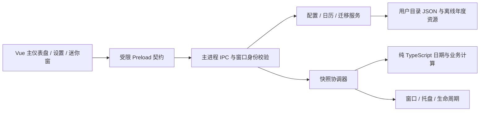

# V2.0.0 技术架构与数据设计

状态：待评审设计，未实施。业务选项和默认值唯一来源为 [REQUIREMENTS](V2.0.0_REQUIREMENTS.md) 的 Q01–Q12；本文件只定义结构和工程约束。任务入口见 [TASKS](V2.0.0_TASKS.md)。

## 分层与依赖方向



- `domain/` 不导入 Electron、Vue、文件系统或全局定时器；显式接收时钟、配置、日历和已确认策略，返回数据或结构化错误。所有业务分支可固定时间测试。
- main 管理 I/O、原生窗口、托盘、单实例和权威配置；renderer 不直接访问 Node 或文件路径，不独立计算另一套业务结果。
- `shared/` 只有类型、IPC DTO、纯验证辅助；domain 可在 main 中调用，renderer 仅消费快照类型。Vue 动画不修改业务进度。
- 不新增 HTTP 服务、数据库、持久后台服务或应用联网下载逻辑。现有 electron-vite dev server 仅用于开发。

## 拟定目录

以下均为后续拟新增/调整项，本轮不创建模块或移动文件。

```text
desktop/src/
  main/
    index.ts                       # 启动顺序和依赖装配
    ipc/router.ts                  # 固定 handler、窗口/框架鉴权、错误 DTO
    services/config-store.ts       # 排队写入、校验、备份、版本及 revision
    services/calendar-store.ts     # 内置年度 + 用户年度包 + 日期覆盖
    services/migration-service.ts  # 只读探测、预览、明确提交
    services/snapshot-service.ts   # 时钟、缓存、窗口订阅与状态快照
    services/clock.ts              # wall clock、resume、时区/日期变化检测
    windows/window-manager.ts      # 主窗、迷你窗、位置恢复、身份登记
    windows/tray-manager.ts        # 常驻引用、菜单、恢复及 tooltip
    lifecycle/single-instance.ts   # 同一用户目录单实例
    lifecycle/quit-coordinator.ts  # 显式退出、落盘及清理
  preload/index.ts                 # 一个自包含 CJS 文件，类型化 API
  shared/contracts.ts             # Config / Snapshot / Result / API
  shared/config-schema.ts         # 纯配置、导入数据校验
  domain/
    local-date.ts                  # civil date、月份、闰年与安全时间解析
    calendar.ts                    # 覆盖优先级、来源、置信度、有界搜索
    employment.ts                  # 在职自然日、累计计划工作日
    schedule.ts                    # 当前/上一日班次、工作/休息区间
    salary.ts                      # 名义日期、调整、跨周期实际日期候选
    overtime.ts                    # shiftDate 归属、有效性、冲突
    progress.ts                    # 区间交集时长和 0–100% 进度
    dashboard.ts                   # 唯一业务快照组合
  renderer/src/
    App.vue
    views/DashboardView.vue
    views/SettingsView.vue
    views/MiniView.vue
    components/{MetricCard,CountdownCard,FishProgress,StatusBadge}.vue
    settings/{ScheduleSettings,SalarySettings,OvertimeSettings,
              AppearanceSettings,DesktopSettings,DataSettings,CalendarSettings}.vue
    composables/{useSnapshot,useSettingsDraft,useTheme,useMotion}.ts
    styles/{tokens,base}.css
desktop/resources/calendar/{manifest,2024,2025,2026}.json
desktop/packaging/                 # 后续原生图标等打包资源
desktop/tests/{unit,desktop,fixtures}/
```

沿用 POC 脚本作为回归基线；拆分测试时保证原有覆盖不丢失。只在有测量依据时引入轻量库；当前优先原生 API 和 Vue composable，不预设 Pinia、日期库或 schema 大依赖。

## 业务输入、状态与快照

建议 DTO：`DashboardSnapshot` 包含 `sequence`、`computedAt`、`localDate`、`timeZoneId`、`configRevision`、`calendarRevision`、`state`、`activeShift`、`employment`、`nextRest`、`salary`、`countdown`、`progress`、`warnings`。日期使用 `YYYY-MM-DD`，时间使用 `HH:MM`，瞬时点用毫秒 epoch；不能混用 civil date 与 UTC timestamp。

`state` 候选为 `rest | beforeWork | working | break | overtime | finished | incomplete`。优先查找仍有效的昨日跨夜班次，再查今日排班；休息日不盖掉进行中的昨日班次。班次结束、重叠处理及上班前目标按 Q03/Q04；涉及业务策略的函数必须收到已确认的 `BusinessPolicies`，不在函数内偷偷选择默认值。

主窗、迷你窗、托盘使用同一 `sequence` / revision 的快照，状态切换时立即刷新。午休冻结工作进度，但墙上时钟倒计时仍变化的规则必须由 Q03/Q05 确认。日历不完整带 warning 和 provenance，计算失败不会返回貌似正确的 0。

日期差使用 civil date 序数；构造本地时刻由可替换的时间适配器完成。跨夜使用明确的下一 civil date；存在 DST 缺失/重复本地时刻时返回异常/歧义，不能 silently 归一化。首发是否只跟随系统时区由 Q12 决定；正式处理策略在 Q12 关闭时补齐用例。

## 配置与数据结构

正式目录建议 `%APPDATA%\Workday Escape\`，与 `%APPDATA%\Workday Escape POC\` 和旧 EXE 旁 `config.json` 分离。迁移来源只读。正式 app 名称/appId 固定，不能因 EXE 位置、临时解压目录或补丁版本改变而产生新配置和第二实例。

| 组 | 拟定字段 | 约束与目的 |
| --- | --- | --- |
| 元数据 | `schemaVersion: 2`、`revision`、`updatedAt`、`appVersion` | schema 与产品版本分开；同一写入成功才递增 revision |
| employee | `startDate: LocalDate \| null` | 未设置显示引导；自然日/工作日口径在 policies，不伪造入职日期 |
| schedule | `workWeek`、`startTime`、`endTime`、`crossMidnight`、`breaks[]` | 一套常规排班；合法区间、正净时长；每周工作日非空 |
| salary | `day`、`nonWorkingPolicy`、`missingDayPolicy`、`showPaydayAsToday` | 1–31；枚举由 Q02 关闭后固定 |
| overtime | `entries[{shiftDate, minutes}]` | 0–600；班次唯一，失效/清理策略由 Q04 决定 |
| calendar | `region`、`enabledYears`、`overrides[date]` | 覆盖条目明确 work/rest，可选当日班次由 Q06 决定；来源可追踪 |
| appearance | `mode`、`accent`、`reduceMotion` | 枚举和受控 token，不接受任意 CSS/HTML |
| desktop | `closeAction`、`miniEnabled`、`alwaysOnTop`、`displayMode`、`bounds` | 模式按 Q07/Q08；窗口矩形按现有屏幕 workArea 重校验 |
| migration | `completed[{sourceKind, sourceHash, migratedAt}]` | 幂等标记；保存来源摘要，不向导出文件泄漏本机完整路径 |

不存储每秒倒计时/进度/工资剩余天数，它们是派生数据。正式配置不得包含未决 Q 的 `TBD` 值；规划中的枚举示例仅供评审，G00 通过前不得生成生产默认配置。当前结构只存一套工作周；若 Q01 选择按历史生效工作制分段统计，D02 开始前须增加带生效日期的工作制段并更新 T02，不能用当前工作周替代真实历史。

其他文件：`settings.json`、最近一次 `settings.backup.json`、失败恢复保存的 `settings.corrupt.<timestamp>.json`、用户 `calendar/<year>.json`、限量诊断日志。导出只含配置、必要用户覆盖和版本；不导出 Chromium cache、诊断日志、机器身份或备份路径。

写入流程：主进程验证完整候选与 expectedRevision → 队列串行写同目录随机临时文件 → flush → 备份旧有效配置 → 同盘原子替换 → 内存配置与 revision 更新 → 发布快照。保存失败不更新内存、不提示成功，保留旧有效文件；针对 Windows 锁定给有界重试，详见 T20。

读取流程：有效正式文件 → 有效备份及可见恢复提示 → 已确认默认/未设置状态。损坏文件原样保留；不认识的未来 schema 只读提示，禁止“恢复默认”覆盖更高版本。严格校验字段和文件大小；导入对象按允许字段构造，禁止原型污染键和任意路径字段。

## 受限 Preload / IPC 合同

每个方法均由固定 handler 处理，不暴露通用 `send/invoke`、`fs`、`shell`、动态 channel 或任意执行入口。

| API 候选 | 请求 | 响应 / 边界 |
| --- | --- | --- |
| `config.read` | 无 | 规范化配置、revision、恢复 warning，不返回本机私有路径 |
| `config.save` | 有限配置 DTO、expectedRevision | `Result<ConfigSnapshot>`；冲突要求重载或预览合并 |
| `snapshot.read` / `snapshot.subscribe` | 无 | 当前快照 / 受控事件；subscribe 返回可调用的解除订阅函数，不传 Electron event |
| `window.perform` | 固定枚举 `showMain/showMini/hideMini/setMiniTop` | 仅本应用窗口；不接收窗口 ID 或任意位置命令 |
| `app.quit` | 无 | 明确进入退出协调器；不得被 closeAction 当成隐藏 |
| `data.previewImport` / `data.applyImport` | 文件由 main 原生对话框选取；提交 previewToken、选择项、expectedRevision | 短期 token 在 main 绑定原文件摘要与预览；变动后重新预览 |
| `data.export` | 已允许导出种类 | main 原生保存对话框；返回结果，不让 renderer 写任意文件 |
| `calendar.preview/apply` | 同上 token 模式 | 年份、schema、日期、来源及冲突校验后整体替换 |

主窗允许全部经授权的方法，迷你窗仅快照、受控切换/置顶和退出；设置/导入必须切回主窗。托盘直接调用 main 服务，不通过 renderer 伪造 IPC。调用者校验已登记的 webContents、主 frame、精确允许 URL/页面；来自 iframe、popup、陌生/销毁窗口的请求拒绝。

错误统一 `Result<T> = {ok:true,data:T} | {ok:false,error:{code,message,field?}}`，code 如 `VALIDATION/REVISION_CONFLICT/IO_BUSY/IO_DENIED/UNSUPPORTED_SCHEMA/CALENDAR_INCOMPLETE`。对用户显示可理解内容，内部路径/堆栈留在受限诊断日志。

## 安全与打包

- 所有窗口保持 `contextIsolation: true`、`sandbox: true`、`nodeIntegration: false`、`webSecurity: true`；Preload 一次打包为单 CJS 文件，不为动画或拖动放宽权限。
- 页面从已打包本地资源加载，禁止导航/新窗口/任意权限和远程代码；生产 CSP 保持 `script-src 'self'`、`connect-src 'none'`，开发 HMR 例外仅开发生效。
- 首发可沿用 `loadFile` 并严格校验页面身份。若后续改 `app://`，仅允许 ASAR 静态根和受控路径，先增加路径穿越与协议测试，不把它当作启用任意本机文件读取的理由。
- 导入包只含 JSON，文件建议上限 1 MiB、日期覆盖不超过 10,000 条；年度包有年份、版本、来源、发布时间和摘要，缺/重复/冲突拒绝。数值限额为工程建议，G00 评审时可调整。
- builder 固定 `portable/x64`，应用与启动器普通用户权限，ASAR，禁止自动 publish。原生托盘图标必须打进 EXE，最终无需外置图标、DLL 或文件夹。
- 正式发布重新核查实际 ASAR 和二进制。Vue 虽列开发依赖，其编译结果是运行内容；不得用 `--omit=dev` 代替资源与漏洞可触达性审查。升级流程见 [POC_CLOSEOUT](POC_CLOSEOUT.md)。

## 单实例、窗口与退出

建议启动顺序：确定并建立固定用户目录 → 获取 `app.requestSingleInstanceLock()` → 失败则退出 → ready 后读取/恢复配置、建立托盘、创建主窗和服务。第二实例只要求已有实例恢复/聚焦，不把 argv 或文件名直接当作导入/命令。[Electron 官方单实例 API](https://www.electronjs.org/docs/latest/api/app#apprequestsingleinstancelockadditionaldata)支持锁和 `second-instance` 事件；锁基准须保证 EXE 副本、临时解压路径变化仍使用同一正式用户目录。

窗口状态：`mainVisible | miniVisible | bothVisible | trayOnly | quitting`；是否允许 bothVisible 由 Q08 决定。主窗 close 事件按 Q07 隐藏或进入 quit；迷你窗关闭仅隐藏它，并保留恢复入口。托盘创建失败时不得出现不可恢复的隐藏进程，保留主窗或提示后退出。断开副屏/DPI变化时把窗口矩形限制在最近屏幕 workArea，至少保留完整可操作区。

明确退出顺序：设置 `isQuitting` → 取消业务订阅/timer和导入 token → 等待已开始的配置写入（建议最多 3 秒，失败可见提示）→ 销毁两个窗口和 tray → 释放锁 → `app.quit`。不得在 before-quit/window-all-closed 中重新创建窗或托盘。多个退出请求幂等。强制系统关机不能无限阻止；通过预先原子保存和备份保证下次可恢复。

托盘保留强引用、Windows 原生图标和恢复/退出菜单；右键打开时重新取当前快照，tooltip 分钟级刷新即可，秒级快捷查看通过即时菜单/迷你窗。[Tray API](https://www.electronjs.org/docs/latest/api/tray)作为实现依据；Windows 特定单击/双击行为须真实验收。

## 时钟、缓存和资源占用

- main 一个协调器：任一可见秒级视图订阅时 1Hz；全部隐藏时切换为下一状态边界、日期边界或最多 60 秒一次的唤醒，不持续绘制。
- cache key 包括 localDate、timeZoneId、configRevision、calendarRevision；累计工作日和下个休息日不每秒遍历历史日期。更改配置/日历、resume、日期/时区跳变立即失效并重算。
- 休眠唤醒采用当前时钟，不能补跑每个遗漏的 tick。系统时间回退不产生负数；复用相同 snapshot sequence 同步两窗。
- 隐藏窗口取消 renderer 订阅并停止动画，保留 Electron 默认后台节流；不要设 `backgroundThrottling:false`。依据 [BrowserWindow 可见性与后台节流说明](https://www.electronjs.org/docs/latest/api/browser-window#page-visibility)，首次 `show:false` 的文档可见性不能单独作为播放许可，main 必须同时确认窗口实际显示。托盘模式可销毁无草稿的隐藏视图；有设置草稿须按 Q12 保留或询问，不能为省内存丢数据。
- fish 使用 CSS transform 和已限制的状态动画；只把业务进度作为输入，禁止多个组件各自设置高频计时器。性能预算和测量方式由 TEST_PLAN G05 统一维护。
