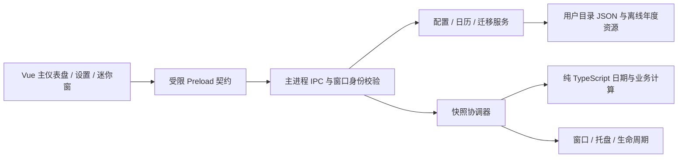

# V2.0.0 技术架构与数据设计

状态：2026-10-14已实施D02–D06基础及D07配置/迁移服务；尚未接入POC运行层，正式IPC/Preload、窗口和UI仍未实施。Q01–Q12事实唯一来源为 [REQUIREMENTS](V2.0.0_REQUIREMENTS.md)；本轮仅D07及其提交/安全推送获新授权，D08–D18未授权。任务入口见 [TASKS](V2.0.0_TASKS.md)。

## 分层与依赖方向



- `domain/` 不导入 Electron、Vue、文件系统或全局定时器；显式接收时钟、配置、日历和已确认策略，返回数据或结构化错误。所有业务分支可固定时间测试。
- main 管理 I/O、原生窗口、托盘、单实例和权威配置；renderer 不直接访问 Node 或文件路径，不独立计算另一套业务结果。
- `shared/` 只有类型、IPC DTO、纯验证辅助；domain 可在 main 中调用，renderer 仅消费快照类型。Vue 动画不修改业务进度。
- 不新增 HTTP 服务、数据库、持久后台服务或应用联网下载逻辑。现有 electron-vite dev server 仅用于开发。

## 拟定目录

下列为完整目标目录：shared、domain日期/时钟/日历/在职/休息/发薪/班次/加班/进度、adapters、只读年度存储及D07配置/迁移服务已实现；dashboard、IPC与窗口/UI仍为规划。旧settings.ts保留POC运行契约，新模块尚未接入POC运行层。

```text
desktop/src/
  main/
    index.ts                       # 启动顺序和依赖装配
    ipc/router.ts                  # 固定 handler、窗口/框架鉴权、错误 DTO
    services/config-store.ts       # 排队写入、校验、备份、版本及 revision
    services/calendar-store.ts     # D04只读内置资源/校验；用户导入和落盘后续
    services/migration-service.ts  # 只读探测、预览、明确提交
    services/snapshot-service.ts   # 时钟、缓存、窗口订阅与状态快照
    services/clock.ts              # wall clock、resume、时区/日期变化检测
    windows/window-manager.ts      # 主窗、迷你窗、位置恢复、身份登记
    windows/tray-manager.ts        # 常驻引用、菜单、恢复及 tooltip
    lifecycle/single-instance.ts   # 同一用户目录单实例
    lifecycle/quit-coordinator.ts  # 后续：显式退出、落盘及清理
  preload/index.ts                 # 一个自包含 CJS 文件，类型化 API
  shared/contracts.ts             # D02：Config / Snapshot / Result / API / Draft
  shared/validation.ts            # D02：安全JSON边界、纯结构验证原语
  shared/config-schema.ts         # D02：配置/可编辑字段/基础格式验证
  shared/capabilities.ts          # D02：固定请求DTO、窗口能力表、revision比较
  shared/settings-draft.ts        # D02：隔离草稿/保存状态辅助，无IO
  shared/formats.ts               # D03：与D02共用日期/时间词法规范
  shared/settings.ts              # POC兼容层，运行行为保留至后续适配
  domain/
    local-date.ts                  # D03：civil date、序数、月份、闰年
    local-time.ts                  # D03：墙上时间、瞬时点、时长转换
    time-zone.ts                   # D03：投影/反解析契约和gap/fold表示
    clock.ts                       # D03：注入ClockSource、固定可调测试时钟
    annual-calendar.ts             # D04年度schema/语义/摘要与可信身份
    calendar.ts                    # D04覆盖优先级、来源、可信度、有界搜索
    calculation-quality.ts         # D05按年份去重的质量/警告纯辅助
    employment.ts                  # D05在职自然日、累计计划工作日
    rest-day.ts                    # D05下一休息日业务DTO
    schedule.ts                    # D06有界候选、解析、半开状态及冲突校验
    salary.ts                      # D05名义日期、三种调整、25周期候选与重合状态
    overtime.ts                    # D06按shiftDate保留/校验/候选更新/目标清除
    progress.ts                    # D06有效区间交集时长及0–100%进度
    dashboard.ts                   # 唯一业务快照组合
  adapters/
    intl-time-zone.ts              # D03：固定输入的原生Intl/ICU时区适配
    system-clock.ts                # D03：集中Date.now和系统时区访问
  renderer/src/
    App.vue
    views/DashboardView.vue
    views/SettingsView.vue
    views/MiniView.vue
    components/{MetricCard,CountdownCard,FishProgress,StatusBadge}.vue
    settings/{ScheduleSettings,SalarySettings,OvertimeSettings,
              AppearanceSettings,DesktopSettings,DataSettings,CalendarSettings}.vue
    composables/{useSnapshot,useSettingsDraft,useTheme,useMotion}.ts
    styles/{tokens,base}.css
desktop/resources/calendar/{manifest,2024,2025,2026}.json
desktop/packaging/                 # 后续原生图标等打包资源
desktop/tests/{unit,desktop,fixtures}/
```

沿用 POC 脚本作为回归基线；拆分测试时保证原有覆盖不丢失。只在有测量依据时引入轻量库；当前优先原生 API 和 Vue composable，不预设 Pinia、日期库或 schema 大依赖。

## 业务输入、状态与快照

建议 DTO：`DashboardSnapshot` 包含 `sequence`、`computedAt`、`localDate`、`timeZoneId`、`configRevision`、`calendarRevision`、`state`、`activeShift`、`employment`、`nextRest`、`salary`、`countdown`、`progress`、`warnings`。日期使用 `YYYY-MM-DD`，时间使用 `HH:MM`，瞬时点用毫秒 epoch；不能混用 civil date 与 UTC timestamp。

业务 `state` 为 `rest | beforeWork | working | break | overtime | finished | incomplete`。先找仍有效的先前开始班次，再查今日排班；基础跨度上限24小时加600分钟可能跨两个日期边界，不能只检查昨日。休息日不盖掉有效跨日班次。按 Q03 上班前目标为开始时刻，班中目标为最终下班；Q04 禁止活动班次重叠。函数显式接收已确认 `BusinessPolicies`，不在内部另选默认值。

主窗、迷你窗、托盘使用同一 `sequence` / revision 快照；两窗互斥可见也需一致状态。午休冻结有效工作进度，墙上时钟倒计时继续减少。净进度排除午休并包含当前班次加班，变更后允许回退；无班次用 null/无进度，不能返回貌似正确的0。

日历判定携带 `source`、`annualVerification`、`approximate` 和涉及年份，按 Q06 传播到休息/发薪/班次及依赖它们的输出。用户日期覆盖明确标为自定义；缺年周规则回退标估算/不完整。累计计划工作日始终标按当前规则推算，缺年另加覆盖不足提示；自然日差独立，不受年度缺失影响。年度包来源/版本字段不等于已完成官方核验，D04核验2024/2025后才允许对应官方核验标记。

日期差使用 civil date 序数；时刻适配器跟随系统本地时间/时区（Q12），跨夜使用明确下一 civil date；resume、时钟/时区/日期变化立即重算。沿用原设计对 DST 缺失/重复时刻返回明确校验错误/歧义，不能自动选未约定的偏移或静默归一化，不新增固定时区选择功能。

## 配置与数据结构

正式目录固定 `%APPDATA%\Workday Escape\`，与 `%APPDATA%\Workday Escape POC\` 和旧 EXE 旁 `config.json` 分离。D07提供createUserConfigStore，由可信Main传入appData根目录；未调用于POC。迁移来源只读。正式 app 名称/appId 固定，不能因 EXE 位置、临时解压目录或补丁版本改变而产生新配置和第二实例。

| 组 | 拟定字段 | 约束与目的 |
| --- | --- | --- |
| 元数据 | `schemaVersion: 2`、`revision`、`updatedAt`、`appVersion` | schema 与产品版本分开；同一写入成功才递增 revision |
| employee | `startDate: LocalDate \| null` | 未设置显示引导；自然日/工作日口径在 policies，不伪造入职日期 |
| schedule | `workWeek`、`startTime`、`endTime`、`crossMidnight`、`breaks[]` | 一套常规排班；合法区间、正净时长；每周工作日非空 |
| salary | `day`、`nonWorkingPolicy`、`missingDayPolicy`、`showPaydayAsToday` | 1–31；默认delay，可advance/none；monthEnd；实际日0（Q02） |
| overtime | `entries[{shiftDate, minutes}]` | 0–600；历史保留，不设按日期自动清理；有效性独立于存储，清除只改目标条目（Q04） |
| calendar | `region`、`enabledYears`、`overrides[date]` | 默认CN/周一至五；仅work/rest日期覆盖，无独立休息日临时班次或当日自定义时间（Q06） |
| appearance | `mode`、`accent`、`reduceMotion` | system/light/dark，海蓝/珊瑚；系统偏好与应用开关取OR，不接受任意CSS/HTML（Q09） |
| desktop | `closeAction`、`miniEnabled`、`alwaysOnTop`、`displayMode`、`bounds` | 默认hideToTray，可quit；mini默认关闭，top手动开关，displayMode固定exclusive；首次主窗、位置恢复（Q07/Q08） |
| migration | `completed[{sourceKind, sourceHash, migratedAt}]` | 幂等标记；保存来源摘要，不向导出文件泄漏本机完整路径 |

不存储每秒倒计时/进度/发薪剩余天数等派生数据。Q01已选择单一当前工作周回算，首发不增加历史工作制分段，累计值明确是推算；未来入职日允许保存并显示未入职。正式配置不含TBD。排班同日/显式跨夜、午休默认关闭；Q确认本身不授予实施权限，本轮D02另获授权仅实现内存类型/结构schema/纯构造，不创建用户配置文件。

历史加班 entries 跨日、结束、重启和导出后仍保留；不把“已结束”写成删除任务。只在用户清除目标班次时修改该条目，保存0分钟等价于该班无加班，其他条目原样保留；具体零值规范化由D02统一，不改变历史保留语义。新增/修改时拒绝无有效排班和活动区间重叠，不能为历史条目自动生成休息日班次。

设置草稿与正式配置分离，使用 main 会话内的有限 `DraftState`（baseRevision、受控字段、dirty）；不落盘、不用于业务快照。切窗前同步并确认草稿，主renderer有草稿时不得直接销毁；恢复主窗时从同一草稿继续。只有显式保存成功才更新正式revision；取消/明确放弃恢复已保存值。

其他文件：`settings.json`、最近一次 `settings.backup.json`、失败恢复保存的 `settings.corrupt.<timestamp>.json`、用户 `calendar/<year>.json`、限量诊断日志。导出只含配置、必要用户覆盖和版本；不导出 Chromium cache、诊断日志、机器身份或备份路径。

写入流程：主进程验证完整候选与 expectedRevision → 队列串行写同目录随机临时文件 → flush → 备份旧有效配置 → 同盘原子替换 → 内存配置与 revision 更新 → 发布快照。保存失败不更新内存、不提示成功，保留旧有效文件；针对 Windows 锁定给有界重试，详见 T20。

读取流程：有效正式文件 → 有效备份及可见恢复提示 → 已确认默认/未设置状态。损坏文件原样保留；不认识的未来 schema 只读提示，禁止“恢复默认”覆盖更高版本。严格校验字段和文件大小；导入对象按允许字段构造，禁止原型污染键和任意路径字段。

## 受限 Preload / IPC 合同

每个方法均由固定 handler 处理，不暴露通用 `send/invoke`、`fs`、`shell`、动态 channel 或任意执行入口。

| API 候选 | 请求 | 响应 / 边界 |
| --- | --- | --- |
| `config.read` | 无 | 规范化配置、revision、恢复 warning，不返回本机私有路径 |
| `config.save` | `settings: EditableConfig`、expectedRevision | Result<ConfigSnapshot>；不接受调用者写schema/revision/更新时间/迁移账本/年度核验元数据 |
| `settingsDraft.read/update/discard` | 有限草稿 DTO / 无 | 仅主窗，main会话内草稿同步；大小/字段受限，不暴露路径或替代正式保存（Q12） |
| `snapshot.read/subscribe/unsubscribe` | IPC请求固定null；subscribe的listener仅留桥接本地 | read返回快照；建立/取消订阅返回Result<null>，推送只含Result<DashboardSnapshot>，不传原始event或序列化回调 |
| `window.perform` | 固定枚举 `showMain/showMini/hideMini/setMiniTop` | 仅本应用窗口；不接收窗口 ID 或任意位置命令 |
| `app.quit` | 无 | 明确进入退出协调器；不得被 closeAction 当成隐藏 |
| `data.previewImport` / `data.applyImport` | main原生文件选择；sourceKind或previewToken、固定枚举selectedFields、expectedRevision、可空的旧加班归属日期 | 精确到字段而非整组覆盖，main绑定源摘要/预览；变化重新预览，不接受任意路径 |
| `data.export` | 已允许导出种类 | main 原生保存对话框；返回结果，不让 renderer 写任意文件 |
| `calendar.preview/apply` | 同上 token 模式 | 年份、schema、日期、来源及冲突校验后整体替换 |

主窗允许全部经授权的方法，迷你窗仅快照、受控切换/置顶和退出；设置/导入必须切回主窗。托盘直接调用 main 服务，不通过 renderer 伪造 IPC。调用者校验已登记的 webContents、主 frame、精确允许 URL/页面；来自 iframe、popup、陌生/销毁窗口的请求拒绝。

错误统一 `Result<T> = {ok:true,data:T} | {ok:false,error:{code,message,field?}}`，code 如 `VALIDATION/REVISION_CONFLICT/IO_BUSY/IO_DENIED/UNSUPPORTED_SCHEMA/CALENDAR_INCOMPLETE`。对用户显示可理解内容，内部路径/堆栈留在受限诊断日志。

## 安全与打包

- 所有窗口保持 `contextIsolation: true`、`sandbox: true`、`nodeIntegration: false`、`webSecurity: true`；Preload 一次打包为单 CJS 文件，不为动画或拖动放宽权限。
- 页面从已打包本地资源加载，禁止导航/新窗口/任意权限和远程代码；生产 CSP 保持 `script-src 'self'`、`connect-src 'none'`，开发 HMR 例外仅开发生效。
- 首发可沿用 `loadFile` 并严格校验页面身份。若后续改 `app://`，仅允许 ASAR 静态根和受控路径，先增加路径穿越与协议测试，不把它当作启用任意本机文件读取的理由。
- 导入包只含 JSON，文件建议上限 1 MiB、日期覆盖不超过 10,000 条；年度包有年份、版本、来源、发布时间和摘要，缺/重复/冲突拒绝。数值限额为工程建议，G00 评审时可调整。
- builder 固定 `portable/x64`，应用与启动器普通用户权限，ASAR，禁止自动 publish。原生托盘图标必须打进 EXE，最终无需外置图标、DLL 或文件夹。
- 正式发布重新核查实际 ASAR 和二进制。Vue 虽列开发依赖，其编译结果是运行内容；不得用 `--omit=dev` 代替资源与漏洞可触达性审查。升级流程见 [POC_CLOSEOUT](POC_CLOSEOUT.md)。

## 单实例、窗口与退出

建议启动顺序：确定并建立固定用户目录 → 获取 `app.requestSingleInstanceLock()` → 失败则退出 → ready 后读取/恢复配置、建立托盘、创建主窗和服务。第二实例只要求已有实例恢复/聚焦，不把 argv 或文件名直接当作导入/命令。[Electron 官方单实例 API](https://www.electronjs.org/docs/latest/api/app#apprequestsingleinstancelockadditionaldata)支持锁和 `second-instance` 事件；锁基准须保证 EXE 副本、临时解压路径变化仍使用同一正式用户目录。

窗口生命周期按下表执行，不保留bothVisible/共存模式。关闭/隐藏/最小化是窗口状态操作，真正退出才结束进程。断开副屏/DPI变化时矩形限制在最近workArea。

| 当前操作 | 目标状态和进程 | 草稿 / 恢复语义 |
| --- | --- | --- |
| 主窗×，默认hideToTray | main隐藏，trayOnly，进程存活；首次说明 | 草稿保留，tray可恢复主窗，不触发“已退出” |
| 主窗最小化 | mainMinimized，任务栏保留，进程存活 | 与hide不同；停止可见动画，草稿保留 |
| 主窗切到mini | miniVisible，先隐藏main再显示mini | 只一个可见窗，草稿确认已同步，不清除 |
| mini切回main | mainVisible，先隐藏mini再恢复/聚焦main | 恢复草稿与位置，不新增共存模式 |
| mini×/隐藏 | trayOnly，进程存活 | 托盘恢复；不强制置顶、不等同退出 |
| 主窗×，用户选closeAction=quit；或托盘退出 | 先执行草稿确认，得到退出许可后quitting | 保存/放弃/继续编辑；保存失败或继续编辑不退出 |
| tray初始化失败 | 保持可操作mainVisible或明确退出 | 不进入无法恢复trayOnly，不能丢草稿 |

首次启动主窗、迷你默认关闭；恢复bounds不自动增加上次可见模式启动。显示迷你需用户动作，置顶由手动开关，不默认强制。主窗和迷你可都驻留但不能同时可见。

明确退出顺序：同步/读取草稿 → 若dirty，提示保存/放弃/继续编辑（主窗隐藏时恢复必要的确认入口）→ 保存成功或明确放弃才许可退出 → 等待已开始写入（原设计最多3秒，有界失败提示并保持应用可操作）→ 设置isQuitting → 取消订阅/timer/token → 销毁窗口和tray、释放锁 → app.quit。保存失败/继续编辑不能提前销毁草稿；确认前不停止服务。关闭到托盘不走此终止链。多个请求幂等，不在退出回调重建窗；强制系统关机通过原子保存/备份恢复而非无限阻止。

托盘保留强引用、Windows 原生图标和恢复/退出菜单；右键打开时重新取当前快照，tooltip 分钟级刷新即可，秒级快捷查看通过即时菜单/迷你窗。[Tray API](https://www.electronjs.org/docs/latest/api/tray)作为实现依据；Windows 特定单击/双击行为须真实验收。

## 时钟、缓存和资源占用

- main 一个协调器：任一可见秒级视图订阅时 1Hz；全部隐藏时切换为下一状态边界、日期边界或最多 60 秒一次的唤醒，不持续绘制。
- cache key 包括 localDate、timeZoneId、configRevision、calendarRevision；累计工作日和下个休息日不每秒遍历历史日期。更改配置/日历、resume、日期/时区跳变立即失效并重算。
- 休眠唤醒采用当前时钟，不能补跑每个遗漏的 tick。系统时间回退不产生负数；复用相同 snapshot sequence 同步两窗。
- 隐藏窗口取消 renderer 订阅并停止动画，保留 Electron 默认后台节流；不要设 `backgroundThrottling:false`。依据 [BrowserWindow 可见性与后台节流说明](https://www.electronjs.org/docs/latest/api/browser-window#page-visibility)，首次 `show:false` 的文档可见性不能单独作为播放许可，main 必须同时确认窗口实际显示。托盘模式可销毁无草稿的隐藏视图；有设置草稿须按 Q12 保留或询问，不能为省内存丢数据。
- fish 使用 CSS transform 和已限制的状态动画；只把业务进度作为输入，禁止多个组件各自设置高频计时器。性能预算和测量方式由 TEST_PLAN G05 统一维护。

## D02 已实现契约与后续接入边界

本节记录实际源码，不表示上面的运行服务/窗口方案已完成。

| 源文件 | 实际职责 |
| --- | --- |
| [contracts.ts](../../../desktop/src/shared/contracts.ts) | AppConfig、EditableConfig、DashboardSnapshot、DraftState、统一Result/Error、主/mini API及请求/响应DTO |
| [validation.ts](../../../desktop/src/shared/validation.ts) | 无Node/Electron/Vue依赖；JSON安全检查与声明式字段验证，白名单重建输出，不展开未知输入 |
| [config-schema.ts](../../../desktop/src/shared/config-schema.ts) | validateAppConfig、基础日期/时间/元数据格式、可编辑字段验证、显式初始输入的配置工厂 |
| [capabilities.ts](../../../desktop/src/shared/capabilities.ts) | 冻结的15项主窗/5项mini能力表、固定请求验证、窗口操作枚举及revision冲突Result |
| [settings-draft.ts](../../../desktop/src/shared/settings-draft.ts) | 创建/编辑隔离草稿、结构就绪保存请求、idle/saving/saved/failed模型；不写文件、不建状态框架 |

### 数据和初始值

- schemaVersion固定2；contractVersion固定1，两者独立。revision为0至MAX_SAFE_INTEGER的安全整数；updatedAt使用UTC的`YYYY-MM-DDTHH:MM:SS.sssZ`格式，appVersion有基础版本格式。
- AppConfig包含employee/schedule/salary/overtime/calendar/appearance/desktop/migration；calendar增加datasets年度来源/版本/摘要/核验状态元数据。结构通过不证明数据来源已官方核验。
- schedule工作周为1–7（周一=1）且非空无重复；breaks每项含时分和0/1开始/结束日期偏移，以便显式表示跨夜午休。D02不判断区间顺序、跨度或重叠。
- createAppConfig必须显式接收入职日期或null、上下班时间、发薪号数、主题模式/配色、更新时间和版本，不把旧POC/V1样例值当新默认。只填已确认/技术初始项：周一至五、无午休、默认delay/monthEnd/当天0、CN、无已启用未核验年度、无加班/迁移记录、hideToTray、mini关闭、不强制置顶、exclusive、未恢复位置、revision0。
- 0分钟是合法保存条目，D02不移除0或旧日期；清除目标/活动性/排班冲突留D06，实际迁移保留和落盘留D07。可编辑日历只含region/enabledYears/overrides，不开放datasets核验元数据写入口；迁移账本和系统元数据不进入普通设置DTO。

### 校验深度

未知字段（含嵌套条目）严格拒绝，不静默合并。旧/更高schema均返回UNSUPPORTED_SCHEMA及legacy/future方向，不自动迁移或降级。缺字段、类型、范围、枚举、重复日期/工作日、基础格式等返回VALIDATION及field/reason/message问题列表。

JSON边界拒绝危险键（任意层级）、类/自定义原型、访问器/隐藏属性、Symbol、函数、undefined、BigInt、非有限数、循环引用和稀疏数组；不调用输入getter/toJSON。按原规划1MiB限制，另有64层/100000节点保护和最多50条普通字段错误。所有返回均为Result，不给Vue抛出原始异常。

日历真实日期/闰年、DST、跨夜区间、午休重叠、班次存在性、薪资/进度均不在D02计算。例如2026-02-31能过基础格式但不等于有效日期；语义链必须在D03–D06补齐、D07实际保存前通过。窗口位置这里只检查有限数与正宽高，屏幕workArea恢复留D08。

### 能力与草稿

逻辑能力名称不等于对renderer暴露任意IPC渠道。mini仅snapshot读/订阅/取消、window受控动作和app.quit；mini不能showMini或访问配置、草稿、导入导出、年度更新。window.perform不接受窗口ID、路径或额外键。role必须由main登记的调用窗口/主框架决定，不能相信renderer.role；D02纯权限表不是已部署的鉴权Handler。

导入选择使用23个固定字段标识，可分别选择schedule.startTime/endTime等；无文件路径、动态字段访问能力或原始Electron事件。预览token/revision绑定、原生文件对话框和实际读写留D07/D09。

DraftState分别持有saved、raw draft、dirty、issues、expectedRevision和保存状态。原配置和编辑输入均复制，无别名；原始非法值保留并标错误，但危险/未知键不进入草稿。键顺序变动不误报dirty，保存中拒绝新编辑；冲突/失败保留旧配置和草稿，成功必须给出验证过的新revision。prepareDraftSave只产生结构就绪DTO，不代表语义通过或实际落盘。以上函数没有时钟、订阅、I/O或窗口行为。

现有window.workday仍是POC三方法；WorkdayV2Api只是类型声明，尚未接到window或Preload。此次生产构建运行文件与旧POC ASAR逐字节一致，electron-builder配置/锁文件未变，无portable重构建需要。

## D03 已实现日期与时钟基础

本节为实际技术契约，不改变Q01/Q03/Q12，不表示日历、发薪或班次业务已实现。所有API复用D02 `Result<T>`；字段/格式/范围错误返回VALIDATION及issues，系统读取异常返回UNAVAILABLE，不抛给渲染页。

### 日历日期和时间 API

| 模块 | 实际API | 边界语义 |
| --- | --- | --- |
| domain/local-date.ts | parseLocalDate、validateCivilDate、formatLocalDate、normalizeLocalDate | 严格YYYY-MM-DD或受控year/month/day；真实公历日期；规范化只补组件零，不接受字符串缺零、不修复溢出 |
| 同上 | isLeapYear、daysInMonth | 延伸公历；整百不闰、整四百闰；年份1–9999、月份1–12 |
| 同上 | toDayOrdinal、fromDayOrdinal、addDays、differenceInDays、compareDates | 0001-01-01为序数0，9999-12-31为3652058；加减安全整数天；差为to-from，未来日期保留负号；比较left/right返回-1/0/1 |
| domain/local-time.ts | parseLocalTime、validateWallTime、formatLocalTime、minutesSinceMidnight、timeFromMinutes | 输入HH:MM，00:00–23:59；WallTime另带0–59秒、0–999毫秒，不支持闰秒；formatLocalTime只输出时分，秒/毫秒须保留在WallTime中 |
| 同上 | minutesToMilliseconds、secondsToMilliseconds、millisecondsToSeconds、millisecondsToMinutes | 有符号时长；转换后的毫秒必须为安全整数，不静默截断；反向转换保留小数，不自动ceil/clamp |
| 同上 | validateInstant、differenceInMilliseconds | epoch整毫秒范围[-62135596800000,253402300799999]，即UTC公历1–9999年；差为to-from，跨日不取模、不丢天数 |

Civil日期差只算整数日期序数，不使用Date、时区或毫秒除以86400000。日期0000/10000、2月不存在日期、月末越界和超范围加减均结构化拒绝，不自动绕回。年1–99无JavaScript Date重映射。格式正则集中shared/formats.ts，D02结构校验复用；D02仍允许2026-02-31的词法结构，后续D07保存/导入必须串接D03真实日期与D06区间语义校验。

LocalDate是日历标签、WallTime是无时区墙上时间、Instant是绝对时间；TimeZoneId解释二者之间的映射。适配器内部序数乘86400000仅用于构造墙上编码并匹配候选UTC瞬时点，不用于自然日差。上海、纽约同一Instant可投影为不同日期；本地相邻午夜之间即使只有23/25小时，Civil差仍为1。Civil范围与Instant范围分别检查，范围边缘若投影或真实候选越界返回错误。

### 时钟、系统适配和 DST

- `Clock.read(): Result<ClockReading>`返回instant、date、time、timeZoneId、offsetMilliseconds。`createClock(source,zones)`显式注入now/timeZoneId和TimeZoneAdapter；每次read重新取二者，不累积tick。
- `createFixedClock(initial,zone,zones)`返回可read/setInstant/advanceMilliseconds/setTimeZone的测试时钟；可向前、回退、跨日、换区，失败更新保持原值。没有真实定时器或系统时间修改。
- `createSystemClock()`集中Date.now和每次重新解析的系统本地时区；也支持固定source注入测试。主进程尚未接入此模块。POC原有Date逻辑保持兼容，正式D05/D06/D09不得再各自访问真实时钟。
- `TimeZoneAdapter.project(instant,zone)`返回墙上日期时间/实际UTC偏移；`resolve(local,zone)`返回unique+instant、nonexistent+空候选、ambiguous+升序候选。缺失/重复不是自动选偏移的成功班次，不静默使用Date溢出规范化；D06必须显式处理结果，没有获批的选择策略时反馈错误/歧义。
- 原生Intl适配固定gregory/latn/h23，用epoch数值formatToParts，无Date民用日期构造；保留历史秒级偏移。未知/当前ICU不支持的时区拒绝，不回退成UTC。仅缓存最多4个formatter，不缓存快照或推送。
- 反解析在墙上编码前后24小时候选UTC区间，以1分钟采样收集ICU偏移并逐一精确往返匹配；偏移绝对值必须小于24小时。已验证正常、纽约DST、Lord Howe半小时、Apia跳日、巴黎历史秒偏移及范围端点。该适配器基于运行时ICU/IANA数据，不含自己的时区库，不宣称覆盖连续生效不足一分钟的假设偏移区段或所有历史政治规则；此类环境需提供另一个TimeZoneAdapter，不静默改产品规则。未来年度映射也只是当前运行时规则。
- 反解析有界但比单次投影贵，本轮测试每次普通反解析约65–95ms（仅开发机观察，不是G05验收）；后续D06/D09应复用已解析班次边界，在配置/日期/时区变化时重建，禁止每秒重复扫描。时钟read只投影一次。没有新增依赖，也未修改性能门槛。

算法取证参考：[ECMA-402 formatToParts](https://tc39.es/ecma402/#sec-intl.datetimeformat.prototype.formattoparts)、[TC39时区候选语义](https://tc39.es/proposal-temporal/#sec-getnamedtimezoneepochnanoseconds)。本实现没有使用或宣称实现完整Temporal。

### 当前验证与后续接入

D03固定输入单元44/44、D02契约31/31、POC逻辑10/10、类型检查与Electron回归7/7（含生产构建）已验证；T01/T07/T11/T17仅基础子项，完整业务案例未验证，见TEST_PLAN的D03分解。休眠事件监听、操作系统真实换区后的运行时刷新、快照调度/缓存/订阅和班次DST策略均未接入/未实机验证，分别留D06/D09/D15。

D03交付时为后续提供解析、序数和日期加减；D04–D06实际接入见后文。D07仍待新授权串接完整语义校验，不复用POC仅当前日目标。

## D04 已实现离线工作日历

源码：[calendar.ts](../../../desktop/src/domain/calendar.ts)、[annual-calendar.ts](../../../desktop/src/domain/annual-calendar.ts)、[calendar-store.ts](../../../desktop/src/main/services/calendar-store.ts)。官方逐项证据与差异见 [D04_CALENDAR_VERIFICATION](D04_CALENDAR_VERIFICATION.md)。所有域计算只接收显式Civil日期/规则和已校验年度，不依赖Electron/Vue/文件系统/网络/真实时钟；星期使用D03序数（序数0为周一），不新增日期算法。

### 年度结构、校验和信任

- `AnnualCalendarPackage.schemaVersion=1`与AppConfig.schemaVersion=2独立；包含region=CN、year、version、升序restDates/workDates、source（全国通知标题/文号/HTTPS政府来源URL/references/真实publishedOn）、coverage、verification声明以及integrity（SHA-256/规范化版本/两类计数）。来源记录可审查，不能把引用URL当联网能力。
- `validateAnnualPackage`安全重建并校验结构/未知或危险键、真实日期/对应年份/升序唯一/互斥、来源年份/标题/无凭据政府HTTPS URL、核验日不早于通知、证据锚点与计数；仅验证声明结构，不凭声明给予核验身份。
- `annualPackagePayload`只编码已验证字段的固定顺序UTF-8 JSON，包含来源、覆盖与核验声明，排除integrity本身；数组强制升序。`createCalendarYear(input,digest,reviewedDigest?)`还校验实际内容SHA；digest由主进程原生node:crypto注入，域模块无Node依赖。计数另验证。SHA用于完整性而非数字签名/真实性。
- `CalendarYear`为冻结的内部校验对象，登记内存身份，不能从未校验/反序列化自称verified对象直接构造Calendar。有效`verification`仅在内容摘要等于受审查内置清单的批准摘要且声明完整时为verified；默认无批准摘要为unverified。该批准参数只由可信主进程装配，不能来自renderer、普通设置或导入包。显示/传播必须使用CalendarYear.verification，不能使用包里的自称verification.status。
- `manifest.json`记录schema/region/version及每年固定文件名、版本、摘要；校验唯一升序、year/file一致，不接路径穿越。`createCalendarStore`核对包数量/年份/版本/摘要，私有批准清单在模块初始化时从内置资源分离复制；陌生/修改后重算摘要的包即使自行提供manifest也不会获官方核验身份。
- `loadBundledCalendarStore`只静态导入manifest、2024、2025、2026 JSON（tsconfig开启resolveJsonModule），提供readYear及独立listMetadata；缺年显式null。无文件选择、扫描用户目录、写配置或导入提交。静态JSON将在未来运行接入时随代码嵌入，不要求外置目录；本轮main/index未引用该服务，现有生产/EXE不含新的运行接入，最终ASAR仍需后续核验。

### 判断、覆盖与可信度 DTO

`createCalendar({workWeek,overrides},years)`只消费调用者明确选择的已校验年集合，不读取/改写AppConfig.enabledYears或初始配置；D07/D09负责正式配置与已选择资源的装配。workWeek为周一1至周日7、非空无重复。覆盖只work/rest，不含日期级上下班时间或临时班次。

`getDay`返回date、weekday、kind/isWorkDay/isRestDay、annual（available/complete/effective verification/version）、D02 DataQuality与结构化CalendarWarning。annual.complete只有核验身份有效且coverage=complete才为true，未核验不能凭覆盖声明标完整。优先级：用户覆盖 > 已核验年度明确日期例外 > 每周规则。未核验年度不当作官方依据，按周回退并标unverified/approximate；已核验partial包可用明确例外，但年度不完整仍保守标估算。完整且核验过的包内普通周一/周末仍source=weekRule，不能标为annual特别安排。coverage完整仅指通知例外完整，不是每一天由官方特别指定。

缺年时source=weekRule、annualVerification=missing、approximate=true、incompleteYears=[year]，warning含CALENDAR_INCOMPLETE/year/reason。用户明确覆盖的日期source=userOverride、approximate=false，无依赖该年缺失的决定警告；annual字段仍如实显示缺年/未核验，不能被误标为官方。后续D05/D06/D09使用完整getDay DTO传播来源和不完整年份，`isWorkDay/isRestDay`仅为基础布尔便利函数，不能用它丢掉可信度。

`validateDateOverrides`校验最多10000真实日期键及work/rest；`overridesFromEntries`拒绝同日重复或冲突；`setDateOverride(...,null)`只删目标并返回新对象。修改/删除后重建Calendar即可恢复原判断；输入规则、原年度和其他覆盖不变。仅内存操作，安全保存/预览确认仍属D07/D11。

### 搜索与后续边界

`findNextWorkDay/findNextRestDay/findCalendarDay`明确includeStart和maxDays（整数1–366）。maxDays是距离上限，距离第366天包含在内；includeStart=true额外检查距离0，所以最多367候选，否则最多366。找到返回found/date/distanceDays/day，穷尽返回notFound/lastDate/maxDays，不返回伪造今天或0；越过D03日期上下界直接Result错误。查询跨年逐日使用对应数据，不循环到无限未来。

搜索聚合全部已检查日的approximate、incompleteYears、warning与最保守年度核验状态；目标日可单独可信，但路径经过缺年仍使搜索结果估算。quality.source是最终检查日来源，过程不完整来自聚合字段。D04交付时未实现反向发薪查找/计划工作日累计；D05的最小搜索扩展及计算见下节，班次/Snapshot、订阅和缓存仍未实现。

本轮已验证类型、D04 46/46、D03 44/44、D02 31/31、原逻辑10/10、Electron7/7含生产构建。2024/2025/2026已逐项人工读官方政府转载核验，固定离线fixture与Python集合差异均0。未新增依赖或改运行打包；2027以后无包按周估算，不编造数据。正式用户年度导入的校验/预览/保存及新增年度人工批准流程须在后续授权内完成，不能借本轮SHA校验自动宣称核验未知来源。

## D05 已实现在职、休息和计划发薪计算

源码：[employment.ts](../../../desktop/src/domain/employment.ts)、[rest-day.ts](../../../desktop/src/domain/rest-day.ts)、[salary.ts](../../../desktop/src/domain/salary.ts)、[calculation-quality.ts](../../../desktop/src/domain/calculation-quality.ts)。只消费显式日期/日历/策略，复用D03 Civil序数和D04完整日历DTO；无Vue/Electron/文件系统/网络/真实时钟或timer，没有Snapshot服务、配置写入或业务缓存。

### API与状态

| API | 输入 | 实际输出与边界 |
| --- | --- | --- |
| calculateElapsedNaturalDays | {startDate:LocalDate或null,today:LocalDate} | unset/null、notStarted/0、employed/非负日差，excludesToday=true，独立exact日期quality；不查询日历 |
| calculateEmployment | 上述输入、Calendar、{maxDays} | DashboardSnapshot.employment所需字段，另有naturalQuality/usesCurrentWorkWeek/checkedDays/warnings；[入职日,今日)逐日计划工作日 |
| calculateNextRestDay | Calendar、today、显式includeStart/maxDays | found/date/days/weekday/isTodayRest/quality/warnings，或notFound而无日期/天数；复用findNextRestDay |
| nominalSalaryDate | year/month/1–31号 | D03 daysInMonth/formatLocalDate，短月取月末，无Date自动溢出 |
| adjustSalaryDate | Calendar、nominalDate、policy（默认delay） | 单周期found/调整原因/有符号shiftDays/完整质量，或有界notFound；none不查询日历 |
| calculateNextSalary | Calendar、today、1–31号、policy（默认delay） | 唯一found可赋给Snapshot.salary；重合ambiguous保留全部周期；无结果notFound，错误仍为Result失败 |

自然日以D03有符号差应用max(0)，未入职/未设置不遍历日历，不用伪造日期。累计计划工作日按当前工作周、年度例外和覆盖回算，不含今天；正常在职结果quality.source=currentSchedule，approximate=true并给CURRENT_RULE_ESTIMATE，独立naturalQuality始终不依赖年度、不标估算。空未来范围为0，unset为null；不把它当实际出勤。

历史遍历预算maxDays由调用者显式提供，合法范围1至D03最大日期差3652058；它是一次计算资源预算，不新增产品允许入职年限。超过预算在遍历前返回VALIDATION/LIMIT，无部分/默认计数；自然日仍可独立计算。累计质量用本次调用内Set/Map按年度/原因去重，内存不随每日诊断增长。没有每秒调度；D09负责预算装配、缓存/失效或必要分段，禁止每秒调用完整历史遍历。极长范围的执行时间、正式缓存和资源预算未验收。

休息日最多366天距离；includeStart=true且今天休息返回0/今天休息标志，false明确排除今天。保留D04途中所有不完整信息，警告affects=nextRest，日期越界失败。不能把notFound转成貌似有效的今天。

### 发薪周期、可信度与失败

- 默认delay、可advance/none。单周期adjust包含名义日：名义日本身工作则位移0；delay找后一个工作日、advance找前一个工作日，两者距离上限366。仅为advance所必需，D04 findCalendarDay增加可选direction（默认forward保持原行为），findPreviousWorkDay封装backward；判断/日期步进/质量聚合没有另复制一套规则，追加3项底层回归。
- 候选为当前名义月份前后各12个月，含当前共25个（Civil边缘少于25）。按D03月长度得基础日，逐一调整；只保留actualDate在[今日,今日+366天]的候选，按Civil序数选最近。不会在名义日当日跳到下月，前月延期/未来月份提前均可入选；不跟踪到账。
- found返回nominalDate/actualDate/days/policy/isPlanned=true/quality，另有isTodayPayday、adjustmentReason、shiftDays、monthEndApplied、cycles与skippedMonthOffsets。实际日等于今天days=0，次日才进入下一有效候选。reason分别policyNone/alreadyWorkDay/delayed/advanced，位移为有符号整数且0不生成-0。
- none只使用名义日期及短月规则，quality为精确日期/annualVerification=notApplicable，不无谓读取/估算日历。delay/advance使用搜索完整质量及警告；结果合并选中周期、重合周期和仍可能进入当前查询范围的更早周期，保留缺年/未核验/partial。无关较晚周期的质量留在cycles诊断，不将已知最近日期无故标成未来缺年估算；source采用最近候选实际日的来源，普通周一不是annual特别安排。
- 所有成功/失败周期均在cycles中有诊断。单周期搜索穷尽是notFound，不能伪造日期；提供者Result错误原样失败，异常转UNAVAILABLE。某周期调整越过Civil范围登记dateBoundary；有其他有效周期时保留该诊断，不能把越界周期变成有效日期。若没有有效目标而遭遇日期边界，返回结构化RANGE错误。
- 名义月份超出1–9999年时跳过并列skippedMonthOffsets，不创建年0/10000或自动规范化。合法日期边缘仍可找到本日；没有合法未来候选时明确RANGE。正常范围内没有目标返回notFound/noWorkingDay或outsideHorizon，区分无工作日和成功候选均在目标范围外。

### 多个周期同日的未决产品表达

已确认Q02能确定最近实际计划日期，但没有定义多个名义周期同日时的唯一周期归属/发薪次数/正式UI文案。当前仅做确定性技术保护：返回status=ambiguous、已确定actualDate/days和按月份排序的全部matchingCycles，不提供假装唯一的nominalDate，不推断几次发薪或舍弃旧周期。重合日在今天仍days=0。

建议后续展示该计划日期及全部重合名义周期；若必须填单一Snapshot.salary名义日期，需用户另行确认，不能自动取最早/最晚周期。该建议未声称已获产品批准；D09/UI接入须显式处理ambiguous（当前类型不允许强行赋给单一salary字段，可保持null并给明确状态），不阻塞D05纯计算和正常唯一候选。REQUIREMENTS Q01–Q12未改。

### 验证与下游

D05交付时单元55/55、日历49/49、日期44/44、契约31/31、旧逻辑10/10、类型及Electron7/7通过。其历史范围保留；D06当前实现见下节，D07/D09仍未开始，未接正式仪表盘/设置/运行服务。

## D06 已实现班次、加班与净工作进度

源码：[schedule.ts](../../../desktop/src/domain/schedule.ts)、[overtime.ts](../../../desktop/src/domain/overtime.ts)、[progress.ts](../../../desktop/src/domain/progress.ts)。复用D02 editableValidators、D03日期/墙上时间/Instant/时区/Clock、D04完整getDay及D05警告转换；不改底层模块、不引入依赖、timer、文件操作、Vue/Electron或Snapshot协调器。

| API | 职责 / 结果 |
| --- | --- |
| validateSchedule | D02白名单结构加纯区间语义：同日正时长/显式跨夜，基础墙上跨度≤24h；常规班内正休息/无重叠/净时长>0 |
| resolveShift | 显式shiftDate/context：ready及ResolvedShift、noShift日历DTO、ambiguous候选；不存在时间/范围/数据错误为Result失败 |
| classifyShift | 已解析班次+Instant+时区，唯一beforeWork/working/break/overtime/finished半开状态；旧时区拒绝 |
| calculateScheduleAt / calculateScheduleWithClock | 显式Instant或一次Clock.read；有界查有效先前班次，再查今日，返回状态/当前班次/倒计时/警告，无运行调度 |
| validateOvertime / overtimeForDate | 按班次日期0–600整数、真实日期/唯一；0和历史不删除，其他日期默认无加班 |
| setOvertimeForShift / updateOvertime | 前者必须注入冲突guard，后者装配实际班次检查；只返回候选新对象，失败旧数据不变 |
| clearOvertimeForShift | 只删除目标记录，其他历史/0保留；休息日旧记录仍可清除 |
| validateShiftConflicts / validateScheduleForDates | 检查目标与必要前后邻班，或调用者显式给定受影响日期集合；不证明无限未来/不写配置 |
| calculateProgress | 已校验ResolvedShift或null、Instant与时区；区间交集/总有效时长、0–100%，无班次为null |

班次起始日固定为shiftDate；结束日只由crossMidnight明确取当日/次日，不比较字符串猜跨夜。显式跨夜相等时刻可表达24小时，同日相等/倒序或跨夜超24拒绝。休息日不生成常规班次，工作周/官方例外/覆盖只有Calendar一个判断来源；后续装配必须让Calendar使用同一schedule.workWeek。

常规班次内休息采用D02已有0/1日期偏移；墙上区间和解析后Instant区间都须正、无重叠、位于常规起止内，常规净工作>0。午休默认[]。基础实际时长也须≤24h，因DST变成25h的整日班次明确拒绝，未自动放宽已确认最长34h界限。加班分钟按真实经过时长追加，finalEnd=normalEnd+minutes×60000，不重置到今日或按午夜清空。

状态采用[start,end)：开始瞬间working，休息开始break/结束working；有加班时normalEnd瞬间overtime，finalEnd瞬间finished。上班前目标startsAt，其余目标finalEndsAt，剩余秒ceil(max(0,target-now)/1000)。今日有排班且先前班已结束则取今日（可尚未上班）；今日无班且先前已结束为rest/null，不继续假装旧加班活动。纯calculateProgress对指定已结束班次仍可计算100%。

当前候选与冲突邻域为锚点Civil日前后各4天（最多9个，日期范围边缘裁剪）。D03支持偏移绝对值<24h，起始至结束最长34h，因此该邻域也覆盖时区偏移跳变导致的日期标签差，不仅昨日；先解开始端点，按最长跨度排除不可能相关的日期，再解其余端点。多个实际活动班次直接DUPLICATE错误，不能按数组次序选归属；邻班首尾相接允许，真正重叠拒绝。

每次调用建立独立session：验证配置/记录一次并按日期索引，端点按zone/date/time复用，显式多目标验证共享该session，不创建跨调用缓存。当前班次含冻结、已登记的ResolvedShift及分离的日历DTO；不冻结调用者输入，反序列化/伪造对象不能直接给状态或进度计算。时区改变后必须重建，不复用旧边界。D09仍需按配置/日历revision/日期/时区缓存与失效，禁止1Hz反复完整反解析；当前Intl分钟采样限制与性能未验收不变。

DST缺失端点为VALIDATION/FORMAT；重复端点保留全部Instant候选，当前受影响时state=incomplete、shift/countdown为null并给TIME_AMBIGUOUS，不能伪造进度或选早/晚偏移。已明确过期的异常旧班不阻塞普通当前日。唯一端点跨DST按实际时间算：纽约00–04春季3h、秋季5h，而Civil日期仍独立；不新增DST选择政策。

有效区间是[start,finalEnd)减去常规休息。elapsed为各有效区间与[start,now)的交集之和，percent=clamp(elapsed/total×100,0,100)，秒/毫秒保留精度。12:30午休时倒计时5:30:00而进度3/8=37.5%；确认1h加班后13:00为3/9≈33.333%、18:00为8/9≈88.889%、19:00为100%。修改配置重建即允许回退，不加单独加班轨道或鱼动画。

Calendar质量沿班次归属日期传播给班次/倒计时/进度；纯毫秒差另有精确timeQuality，不能把算术本身标为缺年估算。无班次的日历状态也保留相应warning。历史加班设置即使当前休息而不活动也保留；更新必须检查有效目标/邻班，清除不影响其他条目。validateScheduleForDates仅验证调用者明确日期集合；D07实际保存须装配当前可能活动班次、受影响未来条目/必要日历覆盖及验证预算，不得用小范围成功声称所有未来日期通过。

本轮D06 55/55，D05 55/55、日历49/49、日期44/44、契约31/31、旧逻辑10/10、类型及Electron7/7含生产构建通过。未实现保存/迁移、Snapshot服务、真实休眠/改时响应、正式UI/动画/托盘/迷你、性能/目标机验收；T17只固定Clock/DST基础通过，D07–D18未开始。

## D07 配置与迁移服务实际合同（2026-10-14）

本节是D07当前实现；前述D02–D06各节保留其交付时历史。服务未被main/index.ts引用，不替换POC settings-store，不注册IPC/Preload能力，不写真实用户目录。

| 模块 | 实际API与职责 |
| --- | --- |
| [config-validation.ts](../../../desktop/src/main/services/config-validation.ts) | editableConfig复用D02草稿白名单；validateConfigSettings串接D02–D06；validateStoredConfig校验正式完整数据及可信年度元数据 |
| [config-files.ts](../../../desktop/src/main/services/config-files.ts) | ConfigFiles可注入read/mkdir/writeExclusiveFlush/replace/remove；Node实现限量读取、独占写入、flush、同目录rename及结构化I/O错误 |
| [config-store.ts](../../../desktop/src/main/services/config-store.ts) | createUserConfigStore固定正式目录；createConfigStore供可信Main/临时测试装配；load/read/initialize/initializeSettings/save/readBackup/prepareRecoveryBase/commitImport |
| [migration-files.ts](../../../desktop/src/main/services/migration-files.ts) | 可信文件选择适配器、私有WeakMap来源句柄、只读来源与独占导出；knownMigrationCandidates仅两个明确来源，不扫描 |
| [migration-service.ts](../../../desktop/src/main/services/migration-service.ts) | preview/previewRecovery/apply/cancel/exportConfig；字段白名单、token及来源摘要复核、成功账本 |

### 读取、校验和有限范围

- 正式文件settings.json，最近有效备份settings.backup.json。读取返回missing/ready/recoverable/invalid/future；I/O故障返回Result错误。recoverable明确标backup、requiresConfirmation及主文件错误；read可读取备份但带可见warning，普通save被阻止。load/read/prepareRecoveryBase/preview均不写配置。
- 首次输入必须明确提供个人日期或null、上下班时间、发薪号数及主题选择；initialize只填D02已确认系统默认，initializeSettings接收完整可编辑设置，可显式跨夜。第一次实际提交revision1，内存临时基底revision0不算保存。
- 结构、真实日期、实际时间区间、净工作>0、加班唯一/0–600、工作周和覆盖、有效班次/冲突全部校验。保存DTO不含schema/revision/appVersion/时间戳/datasets/migration。年度元数据由已选资源在可信CalendarStore中重建；正式读取也要求与该注册表一致，外部自称verified不能升级可信身份。
- D06按Instant识别可能活动的前序班次，过期DST异常及不活动历史不重新变成当前班次。校验今日/必要邻班、明确未来加班和变更的未来日期覆盖；全局排班/年度选择变化另检查未来366天。主进程显式maxValidationDates预算1–10000，超额返回LIMIT，保留旧配置；已知DST缺失/歧义、冲突或超Civil范围均拒绝。
- validateConfigSettings返回checkedShiftDates、checkedClock和warnings。检查范围有界，不证明无限未来或未知ICU规则；全局保存带明确范围warning。D09在新日期/时区/日历变化后必须再次校验，异常不得生成假班次；尚未实现该运行接入。保存末端检查日期/时区及时间回拨，变化时保留旧值并要求重试。
- 不变的历史/0分钟记录不按日期删除。V2导入已结束或休息日历史可作为不活动设置保留；可能仍活动的跨夜记录、新增/修改普通加班及未来条目须通过D06有效班次/冲突判断。无休息日独立班次。
- 文件按stat及最多1MiB+1字节读取，UTF-8严格解码；超大、非文件及读取/解码障碍明确失败并保留源，不自动覆盖这种无法完整取证的文件。可解析UTF-8损坏/缺字段/语义错误与有效备份的恢复已实现。未来schema主文件或备份均只读，不能初始化、默认覆盖或降级恢复。

### 提交、备份和故障边界

请求入队前先安全复制，单服务队列串行处理；入队后仍核对expectedRevision与当前内存值，并用原始内容SHA-256检查磁盘主文件和备份（即使外部未递增revision也冲突）。随机同目录临时文件wx创建、完整规范化JSON写入和文件fsync；旧有效内容同样经临时文件/flush后替换备份，失败不继续危险替换。末端再次检查源、时钟和磁盘，再同卷rename替换正式文件，不先删除旧文件。只有rename成功后才更新内存及revision，失败保留旧值/草稿，可重试。

默认锁定重试最多3次、每次30ms，可信Main可显式设1–5次；磁盘不足/拒绝/忙/其他故障用既有Result错误和可解释文字，不暴露路径或原始堆栈。临时清理失败作为warning；成功保存不因清理失败被说成失败，失败也不会因此变成功。进程中断可留下自身随机tmp，本轮不扫描/删除任意目录。

恢复损坏主文件前保存settings.corrupt.<随机ID>.json原始内容，不用坏内容覆盖有效备份。两份均损坏或首次无配置时，仅完整V2来源可构造内存基底；当前值显示null，必须明确选齐23字段再确认，原主/备份坏内容均另存，未来schema仍禁止。健康文件恢复旧备份，revision=当前有效revision+1；损坏文件仅能确定备份revision时以该有效revision+1提交，不伪造已丢失的修订历史。token另绑定完整规范化基底摘要，避免同数字revision的恢复/重载复用旧预览；D09须同步失效旧草稿和缓存。

迁移前将来源原始内容保存为migration.<SHA-256>.json，源路径不入配置。完成标记和配置在同一settings.json提交中更新，失败可有有效的旧备份或来源副本，但没有成功标记。备份文件/来源副本和主文件不是跨文件数据库事务；不声称任意外部写者之间的CAS。末次摘要检查与rename之间仍有不可完全消除的外部竞争窗口，D08须落实单实例；外部编辑须先退出应用。文件flush与同卷替换已在开发机Windows 11验证，不等于目录元数据已持久化，更不等于所有物理断电/硬件故障均绝不丢数据。

### 迁移能力与兼容扩展

来源只读选择，由Main持有句柄/私有路径；renderer只有sourceKind和预览DTO。knownMigrationCandidates只使用可信Main明确提供的portable原始目录和已知POC用户目录，原始位置未知则不探测EXE旁来源，不用临时解压目录替代。

token随机、10分钟有效、最多16会话，绑定来源能力/种类、原始摘要、revision、规范化基底摘要和允许字段。源、revision或基底改变、取消、超期、回拨后必须重新预览；保存过程中再次复核。重复摘要的preview.alreadyProcessed=true，只有新预览且apply.confirmPreviouslyImported=true才允许重覆，账本不重复追加。该请求字段及preview的notes/expiresAt/alreadyProcessed为D02契约的可选兼容扩展，不新增角色权限、通用路径或运行Handler。

映射详见MIGRATION的D07节。导出是合法schema2 JSON，可再导入；revision归0、账本/datasets为空，不携带缓存/日志/路径/机器身份。日期加班、覆盖、主题和窗口设置保留于可选择业务字段；外部系统字段不应用。导出需可信Main选择新目标，独占创建，已存在目标拒绝覆盖。原生对话框、main草稿协调、Snapshot发布、窗口、UI、年度包导入和最终Portable实机仍在D08–D18。
