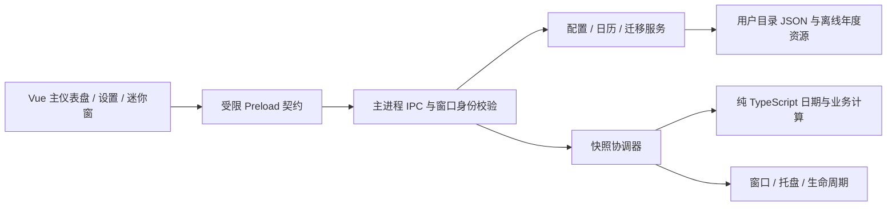

# V2.0.0 技术架构与数据设计

2026-10-19年度能力版本边界：V2.0.0仅以F11-A离线日历基础作为交付范围，保留内置2024–2026、周规则/日期覆盖、来源/版本、缺年估算及依赖结果提示。F11-B外部JSON手动导入未实现但已移出发布前置；本文旧的“导入缺口必须补齐才能最终发布”是历史要求，已被[REQUIREMENTS](V2.0.0_REQUIREMENTS.md)的当前F11拆分覆盖。F11-C可信年度数据自动更新仅在[ROADMAP](../../ROADMAP.md)登记V2.1.0初步方向，不改变V2.0.0的Q06离线策略、生产CSP/IPC、CalendarStore、配置Schema或Snapshot流程；本轮没有实现网络、Actions、数据发布、下载或热更新。

2026-10-16 D12第二轮显示接线修正：猫鱼组件改挂FishProgress，静态波纹复用原PNG遮罩，窗口默认/最小尺寸统一导出；当前视觉以UI_PLAN末节为准，原IPC、暂停、业务和存储合同不变。

2026-10-16 D12：原GIF受控播放/静态帧切换、单轨鱼进度已接入；仅增加本窗口只读可见性DTO，不改Snapshot业务语义、配置或时钟。实现与安全边界见末节，早期静态/未授权描述保留历史上下文。

2026-10-16 D11第三轮：新增纯expected-end映射与一个仅Main的固定草稿能力，临时预计输入不入schema；保留原Snapshot、ConfigStore及退出协调。当前合同见末节。

最新D11增补（2026-10-15）：统一默认配置→立即展示Snapshot→后台安全首存，常用设置前置；Intl偏移复用与协作语义校验的实际合同见文末。旧阶段记录保留，不能把历史首次填表要求作为当前行为。

2026-10-15历史授权（方案A；年度导入交付要求已被2026-10-19范围调整覆盖）：恢复D11主仪表盘、设置、配置迁移/导出/恢复和草稿退出保护。仅外部年度日历包导入不作为D11完成前置；F11仍保留、未全部完成，最终发布仍需该能力实测通过，不代表跨版本延期。内置2024–2026、工作周/日期覆盖、缺年估算/来源与Snapshot更新照常实现。原暂停记录作为历史保留；当前进展见TASKS末节。D12–D18未授权。

当前状态（2026-10-15）：D01–D11阶段基础完成，正式主窗/设置已接D09快照、D10组件与D07服务。生产Preload仅workdayV2，原POC源码/配置保留隔离；新增三个Main固定能力，不改schema2/contractVersion1或业务算法。外部年度导入仍UNAVAILABLE，托盘/真实mini/动态小鱼未实现，D12–D18未授权。历史D08失焦和D09原生异常未宣称修复；GUI门禁关闭。Q01–Q12事实唯一来源为 [REQUIREMENTS](V2.0.0_REQUIREMENTS.md)；当前合同见文末。

历史说明：本日较早因年度底层不足而暂停；用户方案A已将该项从D11阶段前置移除，原缺口仍须单独实现才能满足F11与最终发布。

## 分层与依赖方向



- `domain/` 不导入 Electron、Vue、文件系统或全局定时器；显式接收时钟、配置、日历和已确认策略，返回数据或结构化错误。所有业务分支可固定时间测试。
- main 管理 I/O、原生窗口、托盘、单实例和权威配置；renderer 不直接访问 Node 或文件路径，不独立计算另一套业务结果。
- `shared/` 只有类型、IPC DTO、纯验证辅助；domain 可在 main 中调用，renderer 仅消费快照类型。Vue 动画不修改业务进度。
- 不新增 HTTP 服务、数据库、持久后台服务或应用联网下载逻辑。现有 electron-vite dev server 仅用于开发。

## 拟定目录

下列为完整目标目录：shared、domain、adapters、年度资源、D07配置/迁移服务、D08生命周期和D09运行服务已实现；D10三展示组件、useTheme和styles已实施，views/settings/FishProgress及其他composables/托盘仍为规划。旧settings.ts和POC页面保持独立，新API为workdayV2，不能把POC两字段文件当正式配置。

```text
desktop/src/
  main/
    index.ts                       # 启动顺序和依赖装配
    ipc/router.ts                  # 固定 handler、窗口/框架鉴权、错误 DTO
    services/config-store.ts       # 排队写入、校验、备份、版本及 revision
    services/calendar-store.ts     # D04只读内置资源/校验；用户导入和落盘后续
    services/migration-service.ts  # 只读探测、预览、明确提交
    services/snapshot-service.ts   # 时钟、缓存、窗口订阅与状态快照
    services/clock.ts              # wall clock、resume、时区/日期变化检测
    services/runtime.ts            # D09唯一正式配置/草稿及D08退出装配
    app-identity.ts                # D08固定正式身份、隔离POC/临时profile
    single-instance.ts             # D08启动锁、ready协调、第二实例恢复
    windows/window-manager.ts      # D08窗口注册、互斥与恢复能力
    windows/window-bounds.ts       # D08纯workArea裁剪及有界原生修正
    windows/tray-manager.ts        # 常驻引用、菜单、恢复及 tooltip
    lifecycle/quit-coordinator.ts  # D08草稿退出许可、有界幂等协调
    lifecycle/operation-barrier.ts # D08等待受控写入，不替代D07保存队列
    lifecycle/poc-draft.ts         # D08临时两字段POC表单适配，非V2会话
    lifecycle/background-testing.ts # 仅未打包、受控TEMP测试；禁止原生交互
  preload/index.ts                 # 一个自包含 CJS 文件，类型化 API
  shared/contracts.ts             # D02：Config / Snapshot / Result / API / Draft
  shared/validation.ts            # D02：安全JSON边界、纯结构验证原语
  shared/config-schema.ts         # D02：配置/可编辑字段/基础格式验证
  shared/capabilities.ts          # D02：固定请求DTO、窗口能力表、revision比较
  shared/settings-draft.ts        # D02：隔离草稿/保存状态辅助，无IO
  shared/formats.ts               # D03：与D02共用日期/时间词法规范
  shared/ipc.ts                   # D09固定channel、Result包络校验/错误脱敏
  shared/bridge.ts                # D09固定角色API及本地订阅清理
  shared/settings.ts              # POC兼容层，运行行为保留至后续适配
  domain/
    local-date.ts                  # D03：civil date、序数、月份、闰年
    local-time.ts                  # D03：墙上时间、瞬时点、时长转换
    time-zone.ts                   # D03：投影/反解析契约和gap/fold表示
    clock.ts                       # D03：注入ClockSource、固定可调测试时钟
    annual-calendar.ts             # D04年度schema/语义/摘要与可信身份
    calendar.ts                    # D04覆盖优先级、来源、可信度、有界搜索
    calculation-quality.ts         # D05按年份去重的质量/警告纯辅助
    employment.ts                  # D05在职自然日、累计计划工作日
    rest-day.ts                    # D05下一休息日业务DTO
    schedule.ts                    # D06有界候选、解析、半开状态及冲突校验
    salary.ts                      # D05名义日期、三种调整、25周期候选与重合状态
    overtime.ts                    # D06按shiftDate保留/校验/候选更新/目标清除
    progress.ts                    # D06有效区间交集时长及0–100%进度
    dashboard.ts                   # 唯一业务快照组合
    time-zone-cache.ts             # D09有界复用D03反解析，不增加日期算法
  adapters/
    intl-time-zone.ts              # D03：固定输入的原生Intl/ICU时区适配
    system-clock.ts                # D03：集中Date.now和系统时区访问
  renderer/src/
    App.vue
    views/DashboardView.vue
    views/SettingsView.vue
    views/MiniView.vue
    components/{MetricCard,CountdownCard,FishProgress,StatusBadge}.vue
    settings/{ScheduleSettings,SalarySettings,OvertimeSettings,
              AppearanceSettings,DesktopSettings,DataSettings,CalendarSettings}.vue
    composables/{useSnapshot,useSettingsDraft,useTheme,useMotion}.ts
    styles/{tokens,base}.css
desktop/resources/calendar/{manifest,2024,2025,2026}.json
desktop/packaging/                 # 后续原生图标等打包资源
desktop/tests/{unit,desktop,fixtures}/
```

沿用 POC 脚本作为回归基线；拆分测试时保证原有覆盖不丢失。只在有测量依据时引入轻量库；当前优先原生 API 和 Vue composable，不预设 Pinia、日期库或 schema 大依赖。

## 业务输入、状态与快照

建议 DTO：`DashboardSnapshot` 包含 `sequence`、`computedAt`、`localDate`、`timeZoneId`、`configRevision`、`calendarRevision`、`state`、`activeShift`、`employment`、`nextRest`、`salary`、`countdown`、`progress`、`warnings`。日期使用 `YYYY-MM-DD`，时间使用 `HH:MM`，瞬时点用毫秒 epoch；不能混用 civil date 与 UTC timestamp。

业务 `state` 为 `rest | beforeWork | working | break | overtime | finished | incomplete`。先找仍有效的先前开始班次，再查今日排班；基础跨度上限24小时加600分钟可能跨两个日期边界，不能只检查昨日。休息日不盖掉有效跨日班次。按 Q03 上班前目标为开始时刻，班中目标为最终下班；Q04 禁止活动班次重叠。函数显式接收已确认 `BusinessPolicies`，不在内部另选默认值。

主窗、迷你窗、托盘使用同一 `sequence` / revision 快照；两窗互斥可见也需一致状态。午休冻结有效工作进度，墙上时钟倒计时继续减少。净进度排除午休并包含当前班次加班，变更后允许回退；无班次用 null/无进度，不能返回貌似正确的0。

日历判定携带 `source`、`annualVerification`、`approximate` 和涉及年份，按 Q06 传播到休息/发薪/班次及依赖它们的输出。用户日期覆盖明确标为自定义；缺年周规则回退标估算/不完整。累计计划工作日始终标按当前规则推算，缺年另加覆盖不足提示；自然日差独立，不受年度缺失影响。年度包来源/版本字段不等于已完成官方核验，D04核验2024/2025后才允许对应官方核验标记。

日期差使用 civil date 序数；时刻适配器跟随系统本地时间/时区（Q12），跨夜使用明确下一 civil date；resume、时钟/时区/日期变化立即重算。沿用原设计对 DST 缺失/重复时刻返回明确校验错误/歧义，不能自动选未约定的偏移或静默归一化，不新增固定时区选择功能。

## 配置与数据结构

正式目录固定 `%APPDATA%\Workday Escape\`，与 `%APPDATA%\Workday Escape POC\` 和旧 EXE 旁 `config.json` 分离。D09单实例Main按D08固定身份路径创建唯一D07 ConfigStore，启动只读加载，首次完整设置显式保存才初始化；POC接口只操作POC文件，迁移来源只读。正式app名称/appId固定，不随EXE目录或补丁版本改变。测试仅使用已验证的TEMP profile。

| 组 | 拟定字段 | 约束与目的 |
| --- | --- | --- |
| 元数据 | `schemaVersion: 2`、`revision`、`updatedAt`、`appVersion` | schema 与产品版本分开；同一写入成功才递增 revision |
| employee | `startDate: LocalDate \| null` | 未设置显示引导；自然日/工作日口径在 policies，不伪造入职日期 |
| schedule | `workWeek`、`startTime`、`endTime`、`crossMidnight`、`breaks[]` | 一套常规排班；合法区间、正净时长；每周工作日非空 |
| salary | `day`、`nonWorkingPolicy`、`missingDayPolicy`、`showPaydayAsToday` | 1–31；默认delay，可advance/none；monthEnd；实际日0（Q02） |
| overtime | `entries[{shiftDate, minutes}]` | 0–600；历史保留，不设按日期自动清理；有效性独立于存储，清除只改目标条目（Q04） |
| calendar | `region`、`enabledYears`、`overrides[date]` | 默认CN/周一至五；仅work/rest日期覆盖，无独立休息日临时班次或当日自定义时间（Q06） |
| appearance | `mode`、`accent`、`reduceMotion` | system/light/dark，海蓝/珊瑚；系统偏好与应用开关取OR，不接受任意CSS/HTML（Q09） |
| desktop | `closeAction`、`miniEnabled`、`alwaysOnTop`、`displayMode`、`bounds` | 默认hideToTray，可quit；mini默认关闭，top手动开关，displayMode固定exclusive；首次主窗、位置恢复（Q07/Q08） |
| migration | `completed[{sourceKind, sourceHash, migratedAt}]` | 幂等标记；保存来源摘要，不向导出文件泄漏本机完整路径 |

不存储每秒倒计时/进度/发薪剩余天数等派生数据。Q01已选择单一当前工作周回算，首发不增加历史工作制分段，累计值明确是推算；未来入职日允许保存并显示未入职。正式配置不含TBD。排班同日/显式跨夜、午休默认关闭；Q确认本身不授予实施权限，本轮D02另获授权仅实现内存类型/结构schema/纯构造，不创建用户配置文件。

历史加班 entries 跨日、结束、重启和导出后仍保留；不把“已结束”写成删除任务。只在用户清除目标班次时修改该条目，保存0分钟等价于该班无加班，其他条目原样保留；具体零值规范化由D02统一，不改变历史保留语义。新增/修改时拒绝无有效排班和活动区间重叠，不能为历史条目自动生成休息日班次。

设置草稿与正式配置分离，使用main会话内的有限SettingsDraftSession（saved、受控draft、dirty、expectedRevision）；不落盘、不用于业务快照。首用saved=null，不伪造默认配置。切窗前同步并确认草稿，主renderer有草稿时不得直接销毁；恢复主窗时从同一草稿继续。只有显式保存成功才更新正式revision；取消/明确放弃恢复已保存值。

其他文件：`settings.json`、最近一次 `settings.backup.json`、失败恢复保存的 `settings.corrupt.<timestamp>.json`、用户 `calendar/<year>.json`、限量诊断日志。导出只含配置、必要用户覆盖和版本；不导出 Chromium cache、诊断日志、机器身份或备份路径。

写入流程：主进程验证完整候选与 expectedRevision → 队列串行写同目录随机临时文件 → flush → 备份旧有效配置 → 同盘原子替换 → 内存配置与 revision 更新 → 发布快照。保存失败不更新内存、不提示成功，保留旧有效文件；针对 Windows 锁定给有界重试，详见 T20。

读取流程：有效正式文件 → 有效备份及可见恢复提示 → 已确认默认/未设置状态。损坏文件原样保留；不认识的未来 schema 只读提示，禁止“恢复默认”覆盖更高版本。严格校验字段和文件大小；导入对象按允许字段构造，禁止原型污染键和任意路径字段。

## 受限 Preload / IPC 合同

每个方法均由固定 handler 处理，不暴露通用 `send/invoke`、`fs`、`shell`、动态 channel 或任意执行入口。

| API 候选 | 请求 | 响应 / 边界 |
| --- | --- | --- |
| `config.read` | 无 | 规范化配置、revision、恢复 warning，不返回本机私有路径 |
| `config.save` | `settings: EditableConfig`、expectedRevision | Result<ConfigSnapshot>；不接受调用者写schema/revision/更新时间/迁移账本/年度核验元数据 |
| `settingsDraft.read/update/discard` | 有限草稿 DTO / 无 | 仅主窗，main会话内草稿同步；大小/字段受限，不暴露路径或替代正式保存（Q12） |
| `snapshot.read/subscribe/unsubscribe` | IPC请求固定null；subscribe的listener仅留桥接本地 | read返回快照；建立/取消订阅返回Result<null>，推送只含Result<DashboardSnapshot>，不传原始event或序列化回调 |
| `window.perform` | 固定枚举 `showMain/showMini/hideMini/setMiniTop` | 仅本应用窗口；不接收窗口 ID 或任意位置命令 |
| `app.quit` | 无 | 明确进入退出协调器；不得被 closeAction 当成隐藏 |
| `data.previewImport` / `data.applyImport` | main原生文件选择；sourceKind或previewToken、固定枚举selectedFields、expectedRevision、可空的旧加班归属日期 | 精确到字段而非整组覆盖，main绑定源摘要/预览；变化重新预览，不接受任意路径 |
| `data.export` | 已允许导出种类 | main 原生保存对话框；返回结果，不让 renderer 写任意文件 |
| `calendar.preview/apply` | 同上 token 模式 | 年份、schema、日期、来源及冲突校验后整体替换 |

主窗允许全部经授权的方法，迷你窗仅快照、受控切换/置顶和退出；设置/导入必须切回主窗。托盘直接调用 main 服务，不通过 renderer 伪造 IPC。调用者校验已登记的 webContents、主 frame、精确允许 URL/页面；来自 iframe、popup、陌生/销毁窗口的请求拒绝。

错误统一 `Result<T> = {ok:true,data:T} | {ok:false,error:{code,message,field?}}`，code 如 `VALIDATION/REVISION_CONFLICT/IO_BUSY/IO_DENIED/UNSUPPORTED_SCHEMA/CALENDAR_INCOMPLETE`。对用户显示可理解内容，内部路径/堆栈留在受限诊断日志。

## 安全与打包

- 所有窗口保持 `contextIsolation: true`、`sandbox: true`、`nodeIntegration: false`、`webSecurity: true`；Preload 一次打包为单 CJS 文件，不为动画或拖动放宽权限。
- 页面从已打包本地资源加载，禁止导航/新窗口/任意权限和远程代码；生产 CSP 保持 `script-src 'self'`、`connect-src 'none'`，开发 HMR 例外仅开发生效。
- 首发可沿用 `loadFile` 并严格校验页面身份。若后续改 `app://`，仅允许 ASAR 静态根和受控路径，先增加路径穿越与协议测试，不把它当作启用任意本机文件读取的理由。
- 导入包只含 JSON，文件建议上限 1 MiB、日期覆盖不超过 10,000 条；年度包有年份、版本、来源、发布时间和摘要，缺/重复/冲突拒绝。数值限额为工程建议，G00 评审时可调整。
- builder 固定 `portable/x64`，应用与启动器普通用户权限，ASAR，禁止自动 publish。原生托盘图标必须打进 EXE，最终无需外置图标、DLL 或文件夹。
- 正式发布重新核查实际 ASAR 和二进制。Vue 虽列开发依赖，其编译结果是运行内容；不得用 `--omit=dev` 代替资源与漏洞可触达性审查。升级流程见 [POC_CLOSEOUT](POC_CLOSEOUT.md)。

## 单实例、窗口与退出

启动顺序：ready前确定固定用户目录/sessionData和身份 → 登记second-instance → 获取 `app.requestSingleInstanceLock()` → 失败则退出且不创建窗口 → primary ready后创建主窗；正式配置、Snapshot和托盘后续接入。第二实例只要求已有实例恢复/聚焦，不解释argv/cwd/additionalData。[Electron 官方单实例 API](https://www.electronjs.org/docs/latest/api/app#apprequestsingleinstancelockadditionaldata)支持锁和事件；D08已落实EXE副本、临时解压路径变化仍使用同一正式用户目录。早于主窗就绪的恢复请求排队到ready-to-show，不重复创建；quitting后不恢复，will-quit移除监听并仅释放本实例持有的锁。

窗口生命周期按下表执行，不保留bothVisible/共存模式。关闭/隐藏/最小化是窗口状态操作，真正退出才结束进程。断开副屏/DPI变化时矩形限制在最近workArea。

| 当前操作 | 目标状态和进程 | 草稿 / 恢复语义 |
| --- | --- | --- |
| 主窗×，默认hideToTray | main隐藏，trayOnly，进程存活；首次说明 | 草稿保留，tray可恢复主窗，不触发“已退出” |
| 主窗最小化 | mainMinimized，任务栏保留，进程存活 | 与hide不同；停止可见动画，草稿保留 |
| 主窗切到mini | miniVisible，先隐藏main再显示mini | 只一个可见窗，草稿确认已同步，不清除 |
| mini切回main | mainVisible，先隐藏mini再恢复/聚焦main | 恢复草稿与位置，不新增共存模式 |
| mini×/隐藏 | trayOnly，进程存活 | 托盘恢复；不强制置顶、不等同退出 |
| 主窗×，用户选closeAction=quit；或托盘退出 | 先执行草稿确认，得到退出许可后quitting | 保存/放弃/继续编辑；保存失败或继续编辑不退出 |
| tray初始化失败 | 保持可操作mainVisible或明确退出 | 不进入无法恢复trayOnly，不能丢草稿 |

首次启动主窗、迷你默认关闭；恢复bounds不自动增加上次可见模式启动。显示迷你需用户动作，置顶由手动开关，不默认强制。主窗和迷你可都驻留但不能同时可见。

明确退出顺序：同步/读取草稿 → 若dirty，提示保存/放弃/继续编辑（主窗隐藏时恢复必要的确认入口）→ 保存成功或明确放弃才许可退出 → 等待已开始写入（原设计最多3秒，有界失败提示并保持应用可操作）→ 设置isQuitting → 取消订阅/timer/token → 销毁窗口和tray、释放锁 → app.quit。保存失败/继续编辑不能提前销毁草稿；确认前不停止服务。关闭到托盘不走此终止链。多个请求幂等，不在退出回调重建窗；强制系统关机通过原子保存/备份恢复而非无限阻止。

上述表格是Q07/Q08最终目标。D08没有真实托盘/mini，POC的×暂时请求真正退出并保护未保存输入；不将此过渡路径标为hideToTray完成。D08实际合同见文末，D13才实现默认关闭隐藏及首次说明，D14实现MiniView。

托盘保留强引用、Windows 原生图标和恢复/退出菜单；右键打开时重新取当前快照，tooltip 分钟级刷新即可，秒级快捷查看通过即时菜单/迷你窗。[Tray API](https://www.electronjs.org/docs/latest/api/tray)作为实现依据；Windows 特定单击/双击行为须真实验收。

## 时钟、缓存和资源占用

- main 一个协调器：任一可见秒级视图订阅时 1Hz；全部隐藏时切换为下一状态边界、日期边界或最多 60 秒一次的唤醒，不持续绘制。
- cache key 包括 localDate、timeZoneId、configRevision、calendarRevision；累计工作日和下个休息日不每秒遍历历史日期。更改配置/日历、resume、日期/时区跳变立即失效并重算。
- 休眠唤醒采用当前时钟，不能补跑每个遗漏的 tick。系统时间回退不产生负数；复用相同 snapshot sequence 同步两窗。
- 隐藏窗口取消 renderer 订阅并停止动画，保留 Electron 默认后台节流；不要设 `backgroundThrottling:false`。依据 [BrowserWindow 可见性与后台节流说明](https://www.electronjs.org/docs/latest/api/browser-window#page-visibility)，首次 `show:false` 的文档可见性不能单独作为播放许可，main 必须同时确认窗口实际显示。托盘模式可销毁无草稿的隐藏视图；有设置草稿须按 Q12 保留或询问，不能为省内存丢数据。
- fish 使用 CSS transform 和已限制的状态动画；只把业务进度作为输入，禁止多个组件各自设置高频计时器。性能预算和测量方式由 TEST_PLAN G05 统一维护。

## D02 已实现契约与后续接入边界

本节记录实际源码，不表示上面的运行服务/窗口方案已完成。

| 源文件 | 实际职责 |
| --- | --- |
| [contracts.ts](../../../desktop/src/shared/contracts.ts) | AppConfig、EditableConfig、DashboardSnapshot、DraftState、统一Result/Error、主/mini API及请求/响应DTO |
| [validation.ts](../../../desktop/src/shared/validation.ts) | 无Node/Electron/Vue依赖；JSON安全检查与声明式字段验证，白名单重建输出，不展开未知输入 |
| [config-schema.ts](../../../desktop/src/shared/config-schema.ts) | validateAppConfig、基础日期/时间/元数据格式、可编辑字段验证、显式初始输入的配置工厂 |
| [capabilities.ts](../../../desktop/src/shared/capabilities.ts) | 冻结的15项主窗/5项mini能力表、固定请求验证、窗口操作枚举及revision冲突Result |
| [settings-draft.ts](../../../desktop/src/shared/settings-draft.ts) | 创建/编辑隔离草稿、结构就绪保存请求、idle/saving/saved/failed模型；不写文件、不建状态框架 |

### 数据和初始值

- schemaVersion固定2；contractVersion固定1，两者独立。revision为0至MAX_SAFE_INTEGER的安全整数；updatedAt使用UTC的`YYYY-MM-DDTHH:MM:SS.sssZ`格式，appVersion有基础版本格式。
- AppConfig包含employee/schedule/salary/overtime/calendar/appearance/desktop/migration；calendar增加datasets年度来源/版本/摘要/核验状态元数据。结构通过不证明数据来源已官方核验。
- schedule工作周为1–7（周一=1）且非空无重复；breaks每项含时分和0/1开始/结束日期偏移，以便显式表示跨夜午休。D02不判断区间顺序、跨度或重叠。
- createAppConfig必须显式接收入职日期或null、上下班时间、发薪号数、主题模式/配色、更新时间和版本，不把旧POC/V1样例值当新默认。只填已确认/技术初始项：周一至五、无午休、默认delay/monthEnd/当天0、CN、无已启用未核验年度、无加班/迁移记录、hideToTray、mini关闭、不强制置顶、exclusive、未恢复位置、revision0。
- 0分钟是合法保存条目，D02不移除0或旧日期；清除目标/活动性/排班冲突留D06，实际迁移保留和落盘留D07。可编辑日历只含region/enabledYears/overrides，不开放datasets核验元数据写入口；迁移账本和系统元数据不进入普通设置DTO。

### 校验深度

未知字段（含嵌套条目）严格拒绝，不静默合并。旧/更高schema均返回UNSUPPORTED_SCHEMA及legacy/future方向，不自动迁移或降级。缺字段、类型、范围、枚举、重复日期/工作日、基础格式等返回VALIDATION及field/reason/message问题列表。

JSON边界拒绝危险键（任意层级）、类/自定义原型、访问器/隐藏属性、Symbol、函数、undefined、BigInt、非有限数、循环引用和稀疏数组；不调用输入getter/toJSON。按原规划1MiB限制，另有64层/100000节点保护和最多50条普通字段错误。所有返回均为Result，不给Vue抛出原始异常。

日历真实日期/闰年、DST、跨夜区间、午休重叠、班次存在性、薪资/进度均不在D02计算。例如2026-02-31能过基础格式但不等于有效日期；语义链必须在D03–D06补齐、D07实际保存前通过。窗口位置这里只检查有限数与正宽高，屏幕workArea恢复留D08。

### 能力与草稿

逻辑能力名称不等于对renderer暴露任意IPC渠道。mini仅snapshot读/订阅/取消、window受控动作和app.quit；mini不能showMini或访问配置、草稿、导入导出、年度更新。window.perform不接受窗口ID、路径或额外键。role必须由main登记的调用窗口/主框架决定，不能相信renderer.role；D02纯权限表不是已部署的鉴权Handler。

导入选择使用23个固定字段标识，可分别选择schedule.startTime/endTime等；无文件路径、动态字段访问能力或原始Electron事件。预览token/revision绑定、原生文件对话框和实际读写留D07/D09。

DraftState分别持有saved、raw draft、dirty、issues、expectedRevision和保存状态。原配置和编辑输入均复制，无别名；原始非法值保留并标错误，但危险/未知键不进入草稿。键顺序变动不误报dirty，保存中拒绝新编辑；冲突/失败保留旧配置和草稿，成功必须给出验证过的新revision。prepareDraftSave只产生结构就绪DTO，不代表语义通过或实际落盘。以上函数没有时钟、订阅、I/O或窗口行为。

现有window.workday仍是POC三方法；WorkdayV2Api只是类型声明，尚未接到window或Preload。此次生产构建运行文件与旧POC ASAR逐字节一致，electron-builder配置/锁文件未变，无portable重构建需要。

## D03 已实现日期与时钟基础

本节为实际技术契约，不改变Q01/Q03/Q12，不表示日历、发薪或班次业务已实现。所有API复用D02 `Result<T>`；字段/格式/范围错误返回VALIDATION及issues，系统读取异常返回UNAVAILABLE，不抛给渲染页。

### 日历日期和时间 API

| 模块 | 实际API | 边界语义 |
| --- | --- | --- |
| domain/local-date.ts | parseLocalDate、validateCivilDate、formatLocalDate、normalizeLocalDate | 严格YYYY-MM-DD或受控year/month/day；真实公历日期；规范化只补组件零，不接受字符串缺零、不修复溢出 |
| 同上 | isLeapYear、daysInMonth | 延伸公历；整百不闰、整四百闰；年份1–9999、月份1–12 |
| 同上 | toDayOrdinal、fromDayOrdinal、addDays、differenceInDays、compareDates | 0001-01-01为序数0，9999-12-31为3652058；加减安全整数天；差为to-from，未来日期保留负号；比较left/right返回-1/0/1 |
| domain/local-time.ts | parseLocalTime、validateWallTime、formatLocalTime、minutesSinceMidnight、timeFromMinutes | 输入HH:MM，00:00–23:59；WallTime另带0–59秒、0–999毫秒，不支持闰秒；formatLocalTime只输出时分，秒/毫秒须保留在WallTime中 |
| 同上 | minutesToMilliseconds、secondsToMilliseconds、millisecondsToSeconds、millisecondsToMinutes | 有符号时长；转换后的毫秒必须为安全整数，不静默截断；反向转换保留小数，不自动ceil/clamp |
| 同上 | validateInstant、differenceInMilliseconds | epoch整毫秒范围[-62135596800000,253402300799999]，即UTC公历1–9999年；差为to-from，跨日不取模、不丢天数 |

Civil日期差只算整数日期序数，不使用Date、时区或毫秒除以86400000。日期0000/10000、2月不存在日期、月末越界和超范围加减均结构化拒绝，不自动绕回。年1–99无JavaScript Date重映射。格式正则集中shared/formats.ts，D02结构校验复用；D02仍允许2026-02-31的词法结构，后续D07保存/导入必须串接D03真实日期与D06区间语义校验。

LocalDate是日历标签、WallTime是无时区墙上时间、Instant是绝对时间；TimeZoneId解释二者之间的映射。适配器内部序数乘86400000仅用于构造墙上编码并匹配候选UTC瞬时点，不用于自然日差。上海、纽约同一Instant可投影为不同日期；本地相邻午夜之间即使只有23/25小时，Civil差仍为1。Civil范围与Instant范围分别检查，范围边缘若投影或真实候选越界返回错误。

### 时钟、系统适配和 DST

- `Clock.read(): Result<ClockReading>`返回instant、date、time、timeZoneId、offsetMilliseconds。`createClock(source,zones)`显式注入now/timeZoneId和TimeZoneAdapter；每次read重新取二者，不累积tick。
- `createFixedClock(initial,zone,zones)`返回可read/setInstant/advanceMilliseconds/setTimeZone的测试时钟；可向前、回退、跨日、换区，失败更新保持原值。没有真实定时器或系统时间修改。
- `createSystemClock()`集中Date.now和每次重新解析的系统本地时区；也支持固定source注入测试。主进程尚未接入此模块。POC原有Date逻辑保持兼容，正式D05/D06/D09不得再各自访问真实时钟。
- `TimeZoneAdapter.project(instant,zone)`返回墙上日期时间/实际UTC偏移；`resolve(local,zone)`返回unique+instant、nonexistent+空候选、ambiguous+升序候选。缺失/重复不是自动选偏移的成功班次，不静默使用Date溢出规范化；D06必须显式处理结果，没有获批的选择策略时反馈错误/歧义。
- 原生Intl适配固定gregory/latn/h23，用epoch数值formatToParts，无Date民用日期构造；保留历史秒级偏移。未知/当前ICU不支持的时区拒绝，不回退成UTC。仅缓存最多4个formatter，不缓存快照或推送。
- 反解析在墙上编码前后24小时候选UTC区间，以1分钟采样收集ICU偏移并逐一精确往返匹配；偏移绝对值必须小于24小时。已验证正常、纽约DST、Lord Howe半小时、Apia跳日、巴黎历史秒偏移及范围端点。该适配器基于运行时ICU/IANA数据，不含自己的时区库，不宣称覆盖连续生效不足一分钟的假设偏移区段或所有历史政治规则；此类环境需提供另一个TimeZoneAdapter，不静默改产品规则。未来年度映射也只是当前运行时规则。
- 反解析有界但比单次投影贵，本轮测试每次普通反解析约65–95ms（仅开发机观察，不是G05验收）；后续D06/D09应复用已解析班次边界，在配置/日期/时区变化时重建，禁止每秒重复扫描。时钟read只投影一次。没有新增依赖，也未修改性能门槛。

算法取证参考：[ECMA-402 formatToParts](https://tc39.es/ecma402/#sec-intl.datetimeformat.prototype.formattoparts)、[TC39时区候选语义](https://tc39.es/proposal-temporal/#sec-getnamedtimezoneepochnanoseconds)。本实现没有使用或宣称实现完整Temporal。

### 当前验证与后续接入

D03固定输入单元44/44、D02契约31/31、POC逻辑10/10、类型检查与Electron回归7/7（含生产构建）已验证；T01/T07/T11/T17仅基础子项，完整业务案例未验证，见TEST_PLAN的D03分解。休眠事件监听、操作系统真实换区后的运行时刷新、快照调度/缓存/订阅和班次DST策略均未接入/未实机验证，分别留D06/D09/D15。

D03交付时为后续提供解析、序数和日期加减；D04–D06实际接入见后文。D07仍待新授权串接完整语义校验，不复用POC仅当前日目标。

## D04 已实现离线工作日历

源码：[calendar.ts](../../../desktop/src/domain/calendar.ts)、[annual-calendar.ts](../../../desktop/src/domain/annual-calendar.ts)、[calendar-store.ts](../../../desktop/src/main/services/calendar-store.ts)。官方逐项证据与差异见 [D04_CALENDAR_VERIFICATION](D04_CALENDAR_VERIFICATION.md)。所有域计算只接收显式Civil日期/规则和已校验年度，不依赖Electron/Vue/文件系统/网络/真实时钟；星期使用D03序数（序数0为周一），不新增日期算法。

### 年度结构、校验和信任

- `AnnualCalendarPackage.schemaVersion=1`与AppConfig.schemaVersion=2独立；包含region=CN、year、version、升序restDates/workDates、source（全国通知标题/文号/HTTPS政府来源URL/references/真实publishedOn）、coverage、verification声明以及integrity（SHA-256/规范化版本/两类计数）。来源记录可审查，不能把引用URL当联网能力。
- `validateAnnualPackage`安全重建并校验结构/未知或危险键、真实日期/对应年份/升序唯一/互斥、来源年份/标题/无凭据政府HTTPS URL、核验日不早于通知、证据锚点与计数；仅验证声明结构，不凭声明给予核验身份。
- `annualPackagePayload`只编码已验证字段的固定顺序UTF-8 JSON，包含来源、覆盖与核验声明，排除integrity本身；数组强制升序。`createCalendarYear(input,digest,reviewedDigest?)`还校验实际内容SHA；digest由主进程原生node:crypto注入，域模块无Node依赖。计数另验证。SHA用于完整性而非数字签名/真实性。
- `CalendarYear`为冻结的内部校验对象，登记内存身份，不能从未校验/反序列化自称verified对象直接构造Calendar。有效`verification`仅在内容摘要等于受审查内置清单的批准摘要且声明完整时为verified；默认无批准摘要为unverified。该批准参数只由可信主进程装配，不能来自renderer、普通设置或导入包。显示/传播必须使用CalendarYear.verification，不能使用包里的自称verification.status。
- `manifest.json`记录schema/region/version及每年固定文件名、版本、摘要；校验唯一升序、year/file一致，不接路径穿越。`createCalendarStore`核对包数量/年份/版本/摘要，私有批准清单在模块初始化时从内置资源分离复制；陌生/修改后重算摘要的包即使自行提供manifest也不会获官方核验身份。
- `loadBundledCalendarStore`只静态导入manifest、2024、2025、2026 JSON（tsconfig开启resolveJsonModule），提供readYear及独立listMetadata；缺年显式null。无文件选择、扫描用户目录、写配置或导入提交。静态JSON将在未来运行接入时随代码嵌入，不要求外置目录；本轮main/index未引用该服务，现有生产/EXE不含新的运行接入，最终ASAR仍需后续核验。

### 判断、覆盖与可信度 DTO

`createCalendar({workWeek,overrides},years)`只消费调用者明确选择的已校验年集合，不读取/改写AppConfig.enabledYears或初始配置；D07/D09负责正式配置与已选择资源的装配。workWeek为周一1至周日7、非空无重复。覆盖只work/rest，不含日期级上下班时间或临时班次。

`getDay`返回date、weekday、kind/isWorkDay/isRestDay、annual（available/complete/effective verification/version）、D02 DataQuality与结构化CalendarWarning。annual.complete只有核验身份有效且coverage=complete才为true，未核验不能凭覆盖声明标完整。优先级：用户覆盖 > 已核验年度明确日期例外 > 每周规则。未核验年度不当作官方依据，按周回退并标unverified/approximate；已核验partial包可用明确例外，但年度不完整仍保守标估算。完整且核验过的包内普通周一/周末仍source=weekRule，不能标为annual特别安排。coverage完整仅指通知例外完整，不是每一天由官方特别指定。

缺年时source=weekRule、annualVerification=missing、approximate=true、incompleteYears=[year]，warning含CALENDAR_INCOMPLETE/year/reason。用户明确覆盖的日期source=userOverride、approximate=false，无依赖该年缺失的决定警告；annual字段仍如实显示缺年/未核验，不能被误标为官方。后续D05/D06/D09使用完整getDay DTO传播来源和不完整年份，`isWorkDay/isRestDay`仅为基础布尔便利函数，不能用它丢掉可信度。

`validateDateOverrides`校验最多10000真实日期键及work/rest；`overridesFromEntries`拒绝同日重复或冲突；`setDateOverride(...,null)`只删目标并返回新对象。修改/删除后重建Calendar即可恢复原判断；输入规则、原年度和其他覆盖不变。仅内存操作，安全保存/预览确认仍属D07/D11。

### 搜索与后续边界

`findNextWorkDay/findNextRestDay/findCalendarDay`明确includeStart和maxDays（整数1–366）。maxDays是距离上限，距离第366天包含在内；includeStart=true额外检查距离0，所以最多367候选，否则最多366。找到返回found/date/distanceDays/day，穷尽返回notFound/lastDate/maxDays，不返回伪造今天或0；越过D03日期上下界直接Result错误。查询跨年逐日使用对应数据，不循环到无限未来。

搜索聚合全部已检查日的approximate、incompleteYears、warning与最保守年度核验状态；目标日可单独可信，但路径经过缺年仍使搜索结果估算。quality.source是最终检查日来源，过程不完整来自聚合字段。D04交付时未实现反向发薪查找/计划工作日累计；D05的最小搜索扩展及计算见下节，班次/Snapshot、订阅和缓存仍未实现。

本轮已验证类型、D04 46/46、D03 44/44、D02 31/31、原逻辑10/10、Electron7/7含生产构建。2024/2025/2026已逐项人工读官方政府转载核验，固定离线fixture与Python集合差异均0。未新增依赖或改运行打包；2027以后无包按周估算，不编造数据。正式用户年度导入的校验/预览/保存及新增年度人工批准流程须在后续授权内完成，不能借本轮SHA校验自动宣称核验未知来源。

## D05 已实现在职、休息和计划发薪计算

源码：[employment.ts](../../../desktop/src/domain/employment.ts)、[rest-day.ts](../../../desktop/src/domain/rest-day.ts)、[salary.ts](../../../desktop/src/domain/salary.ts)、[calculation-quality.ts](../../../desktop/src/domain/calculation-quality.ts)。只消费显式日期/日历/策略，复用D03 Civil序数和D04完整日历DTO；无Vue/Electron/文件系统/网络/真实时钟或timer，没有Snapshot服务、配置写入或业务缓存。

### API与状态

| API | 输入 | 实际输出与边界 |
| --- | --- | --- |
| calculateElapsedNaturalDays | {startDate:LocalDate或null,today:LocalDate} | unset/null、notStarted/0、employed/非负日差，excludesToday=true，独立exact日期quality；不查询日历 |
| calculateEmployment | 上述输入、Calendar、{maxDays} | DashboardSnapshot.employment所需字段，另有naturalQuality/usesCurrentWorkWeek/checkedDays/warnings；[入职日,今日)逐日计划工作日 |
| calculateNextRestDay | Calendar、today、显式includeStart/maxDays | found/date/days/weekday/isTodayRest/quality/warnings，或notFound而无日期/天数；复用findNextRestDay |
| nominalSalaryDate | year/month/1–31号 | D03 daysInMonth/formatLocalDate，短月取月末，无Date自动溢出 |
| adjustSalaryDate | Calendar、nominalDate、policy（默认delay） | 单周期found/调整原因/有符号shiftDays/完整质量，或有界notFound；none不查询日历 |
| calculateNextSalary | Calendar、today、1–31号、policy（默认delay） | 唯一found可赋给Snapshot.salary；重合ambiguous保留全部周期；无结果notFound，错误仍为Result失败 |

自然日以D03有符号差应用max(0)，未入职/未设置不遍历日历，不用伪造日期。累计计划工作日按当前工作周、年度例外和覆盖回算，不含今天；正常在职结果quality.source=currentSchedule，approximate=true并给CURRENT_RULE_ESTIMATE，独立naturalQuality始终不依赖年度、不标估算。空未来范围为0，unset为null；不把它当实际出勤。

历史遍历预算maxDays由调用者显式提供，合法范围1至D03最大日期差3652058；它是一次计算资源预算，不新增产品允许入职年限。超过预算在遍历前返回VALIDATION/LIMIT，无部分/默认计数；自然日仍可独立计算。累计质量用本次调用内Set/Map按年度/原因去重，内存不随每日诊断增长。没有每秒调度；D09负责预算装配、缓存/失效或必要分段，禁止每秒调用完整历史遍历。极长范围的执行时间、正式缓存和资源预算未验收。

休息日最多366天距离；includeStart=true且今天休息返回0/今天休息标志，false明确排除今天。保留D04途中所有不完整信息，警告affects=nextRest，日期越界失败。不能把notFound转成貌似有效的今天。

### 发薪周期、可信度与失败

- 默认delay、可advance/none。单周期adjust包含名义日：名义日本身工作则位移0；delay找后一个工作日、advance找前一个工作日，两者距离上限366。仅为advance所必需，D04 findCalendarDay增加可选direction（默认forward保持原行为），findPreviousWorkDay封装backward；判断/日期步进/质量聚合没有另复制一套规则，追加3项底层回归。
- 候选为当前名义月份前后各12个月，含当前共25个（Civil边缘少于25）。按D03月长度得基础日，逐一调整；只保留actualDate在[今日,今日+366天]的候选，按Civil序数选最近。不会在名义日当日跳到下月，前月延期/未来月份提前均可入选；不跟踪到账。
- found返回nominalDate/actualDate/days/policy/isPlanned=true/quality，另有isTodayPayday、adjustmentReason、shiftDays、monthEndApplied、cycles与skippedMonthOffsets。实际日等于今天days=0，次日才进入下一有效候选。reason分别policyNone/alreadyWorkDay/delayed/advanced，位移为有符号整数且0不生成-0。
- none只使用名义日期及短月规则，quality为精确日期/annualVerification=notApplicable，不无谓读取/估算日历。delay/advance使用搜索完整质量及警告；结果合并选中周期、重合周期和仍可能进入当前查询范围的更早周期，保留缺年/未核验/partial。无关较晚周期的质量留在cycles诊断，不将已知最近日期无故标成未来缺年估算；source采用最近候选实际日的来源，普通周一不是annual特别安排。
- 所有成功/失败周期均在cycles中有诊断。单周期搜索穷尽是notFound，不能伪造日期；提供者Result错误原样失败，异常转UNAVAILABLE。某周期调整越过Civil范围登记dateBoundary；有其他有效周期时保留该诊断，不能把越界周期变成有效日期。若没有有效目标而遭遇日期边界，返回结构化RANGE错误。
- 名义月份超出1–9999年时跳过并列skippedMonthOffsets，不创建年0/10000或自动规范化。合法日期边缘仍可找到本日；没有合法未来候选时明确RANGE。正常范围内没有目标返回notFound/noWorkingDay或outsideHorizon，区分无工作日和成功候选均在目标范围外。

### 多个周期同日的未决产品表达

已确认Q02能确定最近实际计划日期，但没有定义多个名义周期同日时的唯一周期归属/发薪次数/正式UI文案。当前仅做确定性技术保护：返回status=ambiguous、已确定actualDate/days和按月份排序的全部matchingCycles，不提供假装唯一的nominalDate，不推断几次发薪或舍弃旧周期。重合日在今天仍days=0。

建议后续展示该计划日期及全部重合名义周期；若必须填单一Snapshot.salary名义日期，需用户另行确认，不能自动取最早/最晚周期。该建议未声称已获产品批准；D09/UI接入须显式处理ambiguous（当前类型不允许强行赋给单一salary字段，可保持null并给明确状态），不阻塞D05纯计算和正常唯一候选。REQUIREMENTS Q01–Q12未改。

### 验证与下游

D05交付时单元55/55、日历49/49、日期44/44、契约31/31、旧逻辑10/10、类型及Electron7/7通过。其历史范围保留；D06当前实现见下节，D07/D09仍未开始，未接正式仪表盘/设置/运行服务。

## D06 已实现班次、加班与净工作进度

源码：[schedule.ts](../../../desktop/src/domain/schedule.ts)、[overtime.ts](../../../desktop/src/domain/overtime.ts)、[progress.ts](../../../desktop/src/domain/progress.ts)。复用D02 editableValidators、D03日期/墙上时间/Instant/时区/Clock、D04完整getDay及D05警告转换；不改底层模块、不引入依赖、timer、文件操作、Vue/Electron或Snapshot协调器。

| API | 职责 / 结果 |
| --- | --- |
| validateSchedule | D02白名单结构加纯区间语义：同日正时长/显式跨夜，基础墙上跨度≤24h；常规班内正休息/无重叠/净时长>0 |
| resolveShift | 显式shiftDate/context：ready及ResolvedShift、noShift日历DTO、ambiguous候选；不存在时间/范围/数据错误为Result失败 |
| classifyShift | 已解析班次+Instant+时区，唯一beforeWork/working/break/overtime/finished半开状态；旧时区拒绝 |
| calculateScheduleAt / calculateScheduleWithClock | 显式Instant或一次Clock.read；有界查有效先前班次，再查今日，返回状态/当前班次/倒计时/警告，无运行调度 |
| validateOvertime / overtimeForDate | 按班次日期0–600整数、真实日期/唯一；0和历史不删除，其他日期默认无加班 |
| setOvertimeForShift / updateOvertime | 前者必须注入冲突guard，后者装配实际班次检查；只返回候选新对象，失败旧数据不变 |
| clearOvertimeForShift | 只删除目标记录，其他历史/0保留；休息日旧记录仍可清除 |
| validateShiftConflicts / validateScheduleForDates | 检查目标与必要前后邻班，或调用者显式给定受影响日期集合；不证明无限未来/不写配置 |
| calculateProgress | 已校验ResolvedShift或null、Instant与时区；区间交集/总有效时长、0–100%，无班次为null |

班次起始日固定为shiftDate；结束日只由crossMidnight明确取当日/次日，不比较字符串猜跨夜。显式跨夜相等时刻可表达24小时，同日相等/倒序或跨夜超24拒绝。休息日不生成常规班次，工作周/官方例外/覆盖只有Calendar一个判断来源；后续装配必须让Calendar使用同一schedule.workWeek。

常规班次内休息采用D02已有0/1日期偏移；墙上区间和解析后Instant区间都须正、无重叠、位于常规起止内，常规净工作>0。午休默认[]。基础实际时长也须≤24h，因DST变成25h的整日班次明确拒绝，未自动放宽已确认最长34h界限。加班分钟按真实经过时长追加，finalEnd=normalEnd+minutes×60000，不重置到今日或按午夜清空。

状态采用[start,end)：开始瞬间working，休息开始break/结束working；有加班时normalEnd瞬间overtime，finalEnd瞬间finished。上班前目标startsAt，其余目标finalEndsAt，剩余秒ceil(max(0,target-now)/1000)。今日有排班且先前班已结束则取今日（可尚未上班）；今日无班且先前已结束为rest/null，不继续假装旧加班活动。纯calculateProgress对指定已结束班次仍可计算100%。

当前候选与冲突邻域为锚点Civil日前后各4天（最多9个，日期范围边缘裁剪）。D03支持偏移绝对值<24h，起始至结束最长34h，因此该邻域也覆盖时区偏移跳变导致的日期标签差，不仅昨日；先解开始端点，按最长跨度排除不可能相关的日期，再解其余端点。多个实际活动班次直接DUPLICATE错误，不能按数组次序选归属；邻班首尾相接允许，真正重叠拒绝。

每次调用建立独立session：验证配置/记录一次并按日期索引，端点按zone/date/time复用，显式多目标验证共享该session，不创建跨调用缓存。当前班次含冻结、已登记的ResolvedShift及分离的日历DTO；不冻结调用者输入，反序列化/伪造对象不能直接给状态或进度计算。时区改变后必须重建，不复用旧边界。D09仍需按配置/日历revision/日期/时区缓存与失效，禁止1Hz反复完整反解析；当前Intl分钟采样限制与性能未验收不变。

DST缺失端点为VALIDATION/FORMAT；重复端点保留全部Instant候选，当前受影响时state=incomplete、shift/countdown为null并给TIME_AMBIGUOUS，不能伪造进度或选早/晚偏移。已明确过期的异常旧班不阻塞普通当前日。唯一端点跨DST按实际时间算：纽约00–04春季3h、秋季5h，而Civil日期仍独立；不新增DST选择政策。

有效区间是[start,finalEnd)减去常规休息。elapsed为各有效区间与[start,now)的交集之和，percent=clamp(elapsed/total×100,0,100)，秒/毫秒保留精度。12:30午休时倒计时5:30:00而进度3/8=37.5%；确认1h加班后13:00为3/9≈33.333%、18:00为8/9≈88.889%、19:00为100%。修改配置重建即允许回退，不加单独加班轨道或鱼动画。

Calendar质量沿班次归属日期传播给班次/倒计时/进度；纯毫秒差另有精确timeQuality，不能把算术本身标为缺年估算。无班次的日历状态也保留相应warning。历史加班设置即使当前休息而不活动也保留；更新必须检查有效目标/邻班，清除不影响其他条目。validateScheduleForDates仅验证调用者明确日期集合；D07实际保存须装配当前可能活动班次、受影响未来条目/必要日历覆盖及验证预算，不得用小范围成功声称所有未来日期通过。

本轮D06 55/55，D05 55/55、日历49/49、日期44/44、契约31/31、旧逻辑10/10、类型及Electron7/7含生产构建通过。未实现保存/迁移、Snapshot服务、真实休眠/改时响应、正式UI/动画/托盘/迷你、性能/目标机验收；T17只固定Clock/DST基础通过，D07–D18未开始。

## D07 配置与迁移服务实际合同（2026-10-14）

本节是D07当前实现；前述D02–D06各节保留其交付时历史。服务未被main/index.ts引用，不替换POC settings-store，不注册IPC/Preload能力，不写真实用户目录。

| 模块 | 实际API与职责 |
| --- | --- |
| [config-validation.ts](../../../desktop/src/main/services/config-validation.ts) | editableConfig复用D02草稿白名单；validateConfigSettings串接D02–D06；validateStoredConfig校验正式完整数据及可信年度元数据 |
| [config-files.ts](../../../desktop/src/main/services/config-files.ts) | ConfigFiles可注入read/mkdir/writeExclusiveFlush/replace/remove；Node实现限量读取、独占写入、flush、同目录rename及结构化I/O错误 |
| [config-store.ts](../../../desktop/src/main/services/config-store.ts) | createUserConfigStore固定正式目录；createConfigStore供可信Main/临时测试装配；load/read/initialize/initializeSettings/save/readBackup/prepareRecoveryBase/commitImport |
| [migration-files.ts](../../../desktop/src/main/services/migration-files.ts) | 可信文件选择适配器、私有WeakMap来源句柄、只读来源与独占导出；knownMigrationCandidates仅两个明确来源，不扫描 |
| [migration-service.ts](../../../desktop/src/main/services/migration-service.ts) | preview/previewRecovery/apply/cancel/exportConfig；字段白名单、token及来源摘要复核、成功账本 |

### 读取、校验和有限范围

- 正式文件settings.json，最近有效备份settings.backup.json。读取返回missing/ready/recoverable/invalid/future；I/O故障返回Result错误。recoverable明确标backup、requiresConfirmation及主文件错误；read可读取备份但带可见warning，普通save被阻止。load/read/prepareRecoveryBase/preview均不写配置。
- 首次输入必须明确提供个人日期或null、上下班时间、发薪号数及主题选择；initialize只填D02已确认系统默认，initializeSettings接收完整可编辑设置，可显式跨夜。第一次实际提交revision1，内存临时基底revision0不算保存。
- 结构、真实日期、实际时间区间、净工作>0、加班唯一/0–600、工作周和覆盖、有效班次/冲突全部校验。保存DTO不含schema/revision/appVersion/时间戳/datasets/migration。年度元数据由已选资源在可信CalendarStore中重建；正式读取也要求与该注册表一致，外部自称verified不能升级可信身份。
- D06按Instant识别可能活动的前序班次，过期DST异常及不活动历史不重新变成当前班次。校验今日/必要邻班、明确未来加班和变更的未来日期覆盖；全局排班/年度选择变化另检查未来366天。主进程显式maxValidationDates预算1–10000，超额返回LIMIT，保留旧配置；已知DST缺失/歧义、冲突或超Civil范围均拒绝。
- validateConfigSettings返回checkedShiftDates、checkedClock和warnings。检查范围有界，不证明无限未来或未知ICU规则；全局保存带明确范围warning。D09在新日期/时区/日历变化后必须再次校验，异常不得生成假班次；尚未实现该运行接入。保存末端检查日期/时区及时间回拨，变化时保留旧值并要求重试。
- 不变的历史/0分钟记录不按日期删除。V2导入已结束或休息日历史可作为不活动设置保留；可能仍活动的跨夜记录、新增/修改普通加班及未来条目须通过D06有效班次/冲突判断。无休息日独立班次。
- 文件按stat及最多1MiB+1字节读取，UTF-8严格解码；超大、非文件及读取/解码障碍明确失败并保留源，不自动覆盖这种无法完整取证的文件。可解析UTF-8损坏/缺字段/语义错误与有效备份的恢复已实现。未来schema主文件或备份均只读，不能初始化、默认覆盖或降级恢复。

### 提交、备份和故障边界

请求入队前先安全复制，单服务队列串行处理；入队后仍核对expectedRevision与当前内存值，并用原始内容SHA-256检查磁盘主文件和备份（即使外部未递增revision也冲突）。随机同目录临时文件wx创建、完整规范化JSON写入和文件fsync；旧有效内容同样经临时文件/flush后替换备份，失败不继续危险替换。末端再次检查源、时钟和磁盘，再同卷rename替换正式文件，不先删除旧文件。只有rename成功后才更新内存及revision，失败保留旧值/草稿，可重试。

默认锁定重试最多3次、每次30ms，可信Main可显式设1–5次；磁盘不足/拒绝/忙/其他故障用既有Result错误和可解释文字，不暴露路径或原始堆栈。临时清理失败作为warning；成功保存不因清理失败被说成失败，失败也不会因此变成功。进程中断可留下自身随机tmp，本轮不扫描/删除任意目录。

恢复损坏主文件前保存settings.corrupt.<随机ID>.json原始内容，不用坏内容覆盖有效备份。两份均损坏或首次无配置时，仅完整V2来源可构造内存基底；当前值显示null，必须明确选齐23字段再确认，原主/备份坏内容均另存，未来schema仍禁止。健康文件恢复旧备份，revision=当前有效revision+1；损坏文件仅能确定备份revision时以该有效revision+1提交，不伪造已丢失的修订历史。token另绑定完整规范化基底摘要，避免同数字revision的恢复/重载复用旧预览；D09须同步失效旧草稿和缓存。

迁移前将来源原始内容保存为migration.<SHA-256>.json，源路径不入配置。完成标记和配置在同一settings.json提交中更新，失败可有有效的旧备份或来源副本，但没有成功标记。备份文件/来源副本和主文件不是跨文件数据库事务；不声称任意外部写者之间的CAS。末次摘要检查与rename之间仍有不可完全消除的外部竞争窗口，D08须落实单实例；外部编辑须先退出应用。文件flush与同卷替换已在开发机Windows 11验证，不等于目录元数据已持久化，更不等于所有物理断电/硬件故障均绝不丢数据。

### 迁移能力与兼容扩展

来源只读选择，由Main持有句柄/私有路径；renderer只有sourceKind和预览DTO。knownMigrationCandidates只使用可信Main明确提供的portable原始目录和已知POC用户目录，原始位置未知则不探测EXE旁来源，不用临时解压目录替代。

token随机、10分钟有效、最多16会话，绑定来源能力/种类、原始摘要、revision、规范化基底摘要和允许字段。源、revision或基底改变、取消、超期、回拨后必须重新预览；保存过程中再次复核。重复摘要的preview.alreadyProcessed=true，只有新预览且apply.confirmPreviouslyImported=true才允许重覆，账本不重复追加。该请求字段及preview的notes/expiresAt/alreadyProcessed为D02契约的可选兼容扩展，不新增角色权限、通用路径或运行Handler。

映射详见MIGRATION的D07节。导出是合法schema2 JSON，可再导入；revision归0、账本/datasets为空，不携带缓存/日志/路径/机器身份。日期加班、覆盖、主题和窗口设置保留于可选择业务字段；外部系统字段不应用。导出需可信Main选择新目标，独占创建，已存在目标拒绝覆盖。原生对话框、main草稿协调、Snapshot发布、窗口、UI、年度包导入和最终Portable实机仍在D08–D18。

## D08 基础运行合同（2026-10-14交付时；D09接入见末节）

### 身份与配置隔离

- APPLICATION_NAME=`Workday Escape`、Windows运行时AUMID=`com.workdayescape`，均不包含版本、EXE位置、工作目录或解压路径。打包器现有appId仍保留POC值，D16复核发布身份；本轮未改变builder策略。
- 正式userData固定为`%APPDATA%\Workday Escape`，Chromium sessionData在其`runtime/`；正式settings.json只能由D07服务在后续授权接入时操作。
- 现有POC三个Handler的路径独立固定为`%APPDATA%\Workday Escape POC\settings.json`，仅保存原两字段；D08绝不将POC格式写入正式目录。旧Python EXE旁config.json仍只作为将来迁移来源，不改写。
- 未打包开发程序的自动化测试需显式`WORKDAY_ESCAPE_TEST_MODE=1`及拥有的绝对TEMP profile，前缀限定workday-desktop-/workday-d08-/workday-lifecycle-/既有验证前缀。测试userData为profile/lifecycle、sessionData为其runtime、POC文件为profile/settings.json。恢复期已禁止packaged EXE接受测试profile、注入退出选择或背景替身；正式启动忽略这些环境变量和任意user-data-dir参数，Renderer不能改变路径或启用测试行为。
- single-instance管理只通知showMain，不执行第二实例参数。正常/并发第二实例立即正常结束，异常取锁结构化失败且无窗口；ready之前的恢复通知保留，重复show使用相同窗口引用。

### 窗口管理与恢复端口

`createWindowManager`只接受Main创建函数及已创建的受控窗口引用，不接受Renderer窗口ID。接口包括ensureMain/showMain/hideMain、registerMini/setMiniEnabled/showMini/hideMini/setMiniTop、registerTrayRecovery、state、beginQuit/abortQuit/dispose。幂等创建、清理closed引用/监听，quitting/disposed禁止再创建；main/mini先隐藏另一窗再显示，隐藏主窗不销毁其表单。

状态为starting/mainVisible/mainMinimized/mainHidden/miniVisible/trayOnly/quitting。正常最小化保留任务栏；mainHidden仅是可跟踪的过渡，全部不可见必须有可用恢复能力。registerTrayRecovery需真实恢复端口成功登记，返回可撤销函数，撤销或能力失效恢复主窗。当前运行代码不登记托盘，测试替身不代表托盘已完成。没有恢复能力时hideMain返回UNAVAILABLE并显示主窗，mini隐藏回主窗；无孤儿隐藏路径。

mini默认关闭、置顶只经手动接口、不创建空白MiniView。主/mini互斥和草稿驻留只在受控替身验证；真正mini、拖动、托盘Explorer重启恢复在D13/D14。

### 草稿、保存屏障与退出

`ExitDraftAdapter`注入read/confirm/save/discard，read返回dirty/saving/identity。D09将真实DraftState会话映射到该端口，保存必须走D07并等待Result；未登记会话返回UNAVAILABLE，绝不假设clean。

流程：等待受控写入 → 读取草稿 → dirty时恢复main并确认save/discard/continueEditing → 复核会话/identity → 等待选择的保存/放弃 → 再等写入/再读clean且notSaving → 唯一commitQuit。并发请求共用Promise，save失败/继续编辑/超时/草稿变化均取消退出并恢复main。运行写入/读取期限3秒，确认期限120秒；超时不取消正在执行的文件保存，不重复发起悬而未决的保存或确认，迟到结果不自动授权退出。dispose解除会话/期限监听并阻止迟到退出。

`operation-barrier`只登记受控Promise/等待清空/许可后seal，不替代D07串行队列、flush/备份/rename/revision协议。D07真实延迟保存fixture验证超时不提前杀主进程、旧文件仍有效、保存完成后才可重试退出。

当前只注册`poc-draft`两时间字段适配：退出时从可信主窗固定DOM读取真实值和busy，与Main已应用值比较；缺失/加载中/非法字段不能被伪造clean。正常POC未保存时仅有原生“返回编辑”反馈，退出取消；保存/放弃/继续编辑三选协议由显式测试注入验证，非法同日输入保存失败留草稿，放弃适配仅恢复两字段已保存值、不写文件。真实三选UI及V2会话最终联动仍在D09/D11。原Renderer/Preload及其三方法不增加权限。此兼容保护不代表正式设置界面/草稿会话/三选UI已完成。

close/before-quit/原quit IPC共用退出入口；许可前preventDefault，许可后设置quitting且不重建窗，下一事件循环app.quit允许IPC回复完成。will-quit清理固定Handler、app/screen监听、显示变化防抖、窗口管理/协调器和锁；正常退出用PID及创建时间追踪捕获的launcher/main子树，不能只凭窗口消失判断。

### workArea与原生边界

`restoreWindowBounds`纯校验有限矩形、选择交集最大display或primary、裁剪整窗到workArea；尺寸/最小值在小屏同时缩小，位置取整。Electron screen和BrowserWindow均DIP，不再乘除scaleFactor。[Screen官方说明](https://www.electronjs.org/docs/latest/api/screen)为坐标依据。

`applyRestoredBounds`等待原生DPI迁移稳定后，最多3次依据实际getBounds修正。150%实机发现奇数601×561 DIP可能被原生取为602×562，精确相等会在相邻尺寸间振荡；改为接受实测矩形完整包含于已裁剪目标，必要时请求600×560，不允许任何屏外容差。最小尺寸随修正请求裁剪；不可修正/已销毁明确失败，不伪报成功。

main在ready-to-show和display-added/removed/metrics-changed时修正，显示事件100ms防抖、进行中修正合并，不高频写配置。本轮不持久化位置；D09经D07保存正式bounds，D14/D15验真实mini/双屏/移动与全部缩放。

## D08 后台测试隔离与恢复合同（2026-10-14）

恢复沿用中断前代码，不重做单实例、窗口管理、退出协议或D02–D07。后台模式必须同时满足：未打包开发程序、已验证的拥有者TEMP profile、TEST_MODE及TEST_BACKGROUND精确标记。packaged EXE在选择目录前关闭testMode，不能由环境变量或user-data-dir启用测试profile、Main测试hook、注入退出选择或窗口替身；正式目录/POC隔离不变，不放宽任何Renderer权限。

后台Electron沿用真实main/index、Preload、Vue及原3个Handler。窗口show=false、focusable=false，跳过启动/activate显示和显示器事件修正；show/showInactive/focus/restore/minimize的测试端口抛错并记录尝试，不修改isVisible/isFocused/isMinimized来伪造结果。WindowManager捕获后返回UNAVAILABLE，不把它记为恢复成功。dirty退出若未注入确认端口则明确拒绝，不打开原生对话框，不默认丢弃；配置/保存/退出协议仍真实执行。真实显示/聚焦等仍只能由GUI组验收。

默认playwright.config只匹配background.spec.ts；playwright.gui.config独立匹配原21项GUI。scripts/gui-authorization.mjs默认拒绝全部GUI入口，不接受环境变量或参数解锁。本轮依据用户明确授权，仅使用忽略目录中的本地许可：绑定D08任务、项目绝对路径、HEAD、最长1小时有效期和各入口有限次数；调用前校验并消耗次数。没有通用解锁命令。本轮结束已删除许可，未来必须重新获得用户授权；不要求用户创建账户或独立机器。两条Portable验证脚本在任何临时文件/进程创建前调用同一门禁。test:unit串行复用既有8套Node脚本，windowsHide=true，无额外依赖。

最新完整GUI仍20 PASS / 1 FAIL：通知时已聚焦、随后失焦的原生断言失败历史保留。后来一次带前台/进程追踪的同断言单项1/1 PASS、没有blur，不能将外部抢焦点推测当根因或称全套21/21。原能力标准不要求同批完整记录，本轮依据用户分批证据授权完成D08阶段基础并登记焦点稳定风险；不改变Q07/Q08/Q12、断言或发布门槛。原生托盘/迷你/正式草稿UI仍未实现，D09未开始。

观察器`tests/helpers/d08-focus-observer.ps1`只由GUI测试读入，仅15秒有界WinEvent/前台只读采样及拥有者进程时间查询；默认background组不加载它。正式src/out无该观察器引用，builder只包含out/package；正式packaged测试标记继续关闭。诊断不增加应用API，也不作置顶/循环focus修复。最新原始证据、时间误差及辅助修正验证限制见TEST_PLAN的单项历史节。

### 本地Portable验收包隔离（本轮实际实现）

`package:win:test`仅在忽略的临时项目副本中增加`d08-test-entry.cjs`，生成明确命名的`release/d08-gui/Workday-Escape-D08-TEST-win-x64.exe`。入口要求已有、真实路径位于系统TEMP下的拥有者测试目录，在加载生产Main前设置Electron原生appData；非法目录立即失败。正式`out`、package main、builder配置及`package:win`不写入该入口。正式EXE仍忽略测试profile/hook/窗口替身，测试包也保持app.isPackaged=true和原安全配置；该包只用于本地验收，不是正式发布产物。

验证脚本先检查测试标识、EXE/ASAR摘要、入口全文以及ASAR中生产Main/Preload/Vue与当前编译产物逐字节一致，才创建fixture并启动。临时appData下的正式V2哨兵与POC目录分开，两组验证14/14与7/7通过；真实用户配置存在状态/摘要前后相同。构建副本及运行fixture已清理，测试EXE和JSON证据保留在忽略目录，不提交。实际环境、摘要、限制及恢复入口见TEST_PLAN文末。

## D09 统一运行服务实际合同（2026-10-14）

本节覆盖上文历史阶段的“尚未接入”描述；没有改Q01–Q12、D08焦点断言或G05预算。以下模块无新增第三方依赖。

| 模块 | 实际入口 / 职责 |
| --- | --- |
| domain/dashboard.ts | createDashboardEngine(config, CalendarProvider, TimeZoneAdapter, maxHistoryDays)：纯组合D03–D06，calculate(ClockReading)/invalidate；不读取真实时间或文件 |
| domain/time-zone-cache.ts | createTimeZoneCache：有界复用D03 resolve结果及副本，clear；不推断DST偏移 |
| main/services/snapshot-service.ts | setConfig/read/subscribe/invalidate/dispose；唯一缓存、计算代次/任务票据及会话内单调sequence |
| main/services/clock.ts | createRefreshCoordinator：一个可注入TimerPort，可信窗口订阅与原生可见性、wake/visibilityChanged/dispose |
| main/services/runtime.ts | createRuntime：唯一D07 store、权威配置和D02草稿、保存/可注入迁移、D08 ExitDraftAdapter；combineExitDrafts同时保护POC与正式草稿 |
| main/ipc/router.ts | 固定15个handler；register/revokeSubscription/dispose；身份、主Frame、精确URL、角色、请求DTO校验 |
| shared/ipc.ts / bridge.ts | 固定channel、JSON/Result包络和错误脱敏；主/mini类型化API、本地listener去重及清理；不暴露通用transport |

### 快照组成与异常

每次read只读取一次D03 Clock，所有计算共用该instant/date/timeZoneId。D05生成在职、休息和发薪，D06选择仍活动的先前开始班次/当日班、目标及有效进度；没有复制日期、午休或加班算法。schedule.ts仅抽取原状态/倒计时表达为summarizeResolvedShift，复用可信ResolvedShift；反序列化对象不获得此资格。

配置存储成功前不切换业务输入。无正式配置/无法读时钟返回受控Result失败，不伪造有效倒计时；计算异常受控返回，部分业务缺失返回incomplete及相关null/警告。历史加班从未按日期删除。有效备份只读使用时附CONFIG_INCOMPLETE，正式恢复仍需预览确认。

最小契约扩展：employment.naturalQuality独立保存自然日精确性，不能混成计划工作日的缺年估算；salaryAmbiguity为可选JSON对象，保存完整原始D05 ambiguous DTO（matchingCycles、cycles等），salary=null并标incomplete，未决定新的发薪展示或单一归属规则。SettingsDraftSession为原DraftState或saved=null/expectedRevision=0的UninitializedDraftState；原D02构造/纯草稿函数仍要求真实AppConfig，不以默认值伪造首用已保存配置。schemaVersion仍2、contractVersion仍1；新API消费者须判断saved是否为空。

### 调度、缓存和失效

- 任一实际可见且未最小化窗口订阅时约1000ms；其他情况最多60000ms，按已解析班次/休息区间边界及本地午夜缩短等待。可见性来自注册的Main端口，不能依赖show=false文档的visibilityState。
- TimerPort只管理一个timer；日期/时区变化在下一次实际clock读取发现，隐藏最长60秒。powerMonitor.resume清除时区反解析缓存并立即wake(true)；恢复读取当前时间，不补跑错过tick。
- 日级缓存键为localDate/timeZoneId/offset；每个engine绑定不可变config代次和当前已选日历。当天在职历史/下一休息/发薪只算一次；正常单调秒级变化复用ResolvedShift和净区间，结束上一跨夜班后重选当日班。回拨、换日/时区/offset、保存、覆盖/工作周改变、迁移和resume均使相应缓存失效。
- engine反解析端点缓存最多256项，Main复用D03 resolve的缓存最多4096项；不缓存新时区为旧偏移，不自行选择gap/fold。当前候选仍经D06校验，歧义不生成假倒计时。
- calendarRevision是Main会话内可信日历设置/工作周变化计数，未持久化、未从renderer采信；configRevision来自D07成功提交。generation/ticket拒绝异步旧配置或旧时钟结果，sequence只对最新有效快照增加；同一clock/config状态共用缓存序号，进程重开可重新计数。
- Main明确配置maxHistoryDays=100000、maxValidationDates=10000作为资源预算，并非产品允许入职年限。历史预算不足保留独立自然日、计划日=null与警告，不返回部分计数。极长历史、非UTC首次366天语义校验与UI响应仍须D15测量。

### 配置、草稿与退出装配

单实例锁成功后Main只创建一个正式ConfigStore和runtime。missing不写settings.json、不猜用户时间/入职/发薪；损坏/未来版本保留源，不能按首用覆盖。显式config.save走D02 DTO、D07完整语义/revision/外部摘要及同一D08写入屏障；仅成功才接受权威配置、重建草稿/快照。失败保留旧配置及用户draft；保存期间拒绝新的编辑、放弃和并发保存。草稿在Main内存，隐藏和renderer重新加载不销毁。

combineExitDrafts读两域真实dirty/saving/identity，一次交给D08协调；保存失败或继续编辑不授权退出，明确放弃才清各目标草稿。保留D08的3秒受控保存/排空期限，超时返回IO_BUSY，正在进行的写入不取消/不强杀；完成后可重新退出。当前实测首次非UTC完整校验可超过期限，不能称G05性能达标。正常运行仍只提供原有“返回编辑”反馈，真实三选界面在D11；没有默认模拟用户选择。成功退出销毁renderer，验收以文件revision及实际进程结束为准，不要求已销毁页面收到成功回包。

### IPC与POC隔离

Main信任自身register的webContents角色，要求存活窗口、同一mainFrame对象和精确页面URL；旧事件/iframe/未知sender/越权mini/非法DTO拒绝。重导航、窗口销毁、取消订阅及will-quit释放订阅；退出移除handler、timer和resume监听。Mini仅具快照、限定窗口命令及退出能力，实际MiniView仍未开发。Preload仅主Frame暴露workdayV2，不提供Node/fs/shell/动态channel或原始event；Result包络与JSON均校验，异常不泄漏内部路径/堆栈。

旧workday三个方法和POC两字段仍单独运行，不初始化正式配置、不把POC输入作为V2已确认配置。正式路径/测试TEMP由D08身份模块提供，打包应用继续忽略测试profile/注入选择/后台替身。原sandbox/contextIsolation/noNode/webSecurity/CSP/导航/权限基线保留，未改builder或Portable策略。

D07迁移/导出可经可信Main注入MigrationService，成功应用更新正式revision并失效旧草稿/快照，dirty时拒绝应用；已用真实D07临时文件服务测试。当前生产装配未提供原生来源/目标选择，data接口返回UNAVAILABLE；年度导入同样UNAVAILABLE。D11再接可信选择、预览确认和恢复交互，不能返回假成功或自动探测导入真实用户文件。D09交付时D10–D18、视觉预览确认尚未执行；本轮D10进展见下节。真实休眠/调时、多窗/托盘与G05/干净目标机仍未验收。

## D10 视觉基础实际合同（2026-10-14）

G00原主/补两图及补充v1获用户确认，详见UI_PLAN；default ocean、optional coral、原蓝猫抱灰鱼不改。配置schema/IPC/业务Snapshot/Main/Preload和POC生产入口均未修改。

| 模块 | 责任与边界 |
| --- | --- |
| renderer/src/styles/{tokens,base}.css | `.workday-ui`显式作用域，四配色、排版、间距、边框/焦点/控件、高对比度系统色、减少动画基础；不污染POC或作用域外DOM |
| renderer/src/ui/appearance.ts | Appearance复用D02 AppConfig类型/已有validator；resolveAppearance纯映射，createThemeController注入单host和dark/motion MediaPort；必填偏好，不自行猜保存默认值；非法输入Result失败、dispose移除监听/恢复属性 |
| renderer/src/composables/useTheme.ts | Vue挂载后才访问matchMedia，监听host/偏好，卸载/换host释放controller；不访问APPDATA/IPC/持久化 |
| renderer/src/ui/presentation.ts | 纯文案和显示守卫，完整BusinessState文字/语义色映射、数字显示格式/空值；不引入日期/秒差/薪资/进度算法 |
| renderer/src/components/{CountdownCard,MetricCard,StatusBadge}.vue | props/slot驱动的实际Vue展示；API、空值和aria约束详见UI_PLAN/preview README；没有新时钟、业务状态推断或实时订阅 |
| renderer/src/preview/*、preview/index.html、vite.components.config.ts | 单独开发/构建入口；固定fixtures和OriginalStill静态原GIF，限定本地源；不被electron-vite生产入口引用，不创建BrowserWindow或写用户文件 |

两个窗口未来共享同一Token和主题模块，每窗各自host/媒体监听；D11对接D09权威配置及Snapshot，必须把来源/估算/异常按字段传播。主题即时预览与保存取消由D11草稿协议决定；D10只提供update/dispose，不提前写保存状态管理。D12通过illustration插槽接受控原GIF动画，静态样例不代表取消动画。真实Mini/Tray仍D13/D14。

测试复用现有Vite+Vue编译/SSR、Node test和Playwright，不引入依赖。独立SSR及浏览器bundle、截图/JSON均写忽略的test-results；`test:unit`加入D10，默认desktop仍仅真实hidden/nonfocusable后台组。生产builder/main入口不变，不含组件预览、文档图片或测试观察器；不需重打Portable。Headless/当前用户隐藏回归及原生异常限制见TEST_PLAN，G05性能数值不变。

## D11 前置审查：实际能力与规划的差距（2026-10-15，前一回合历史）

上文“用户calendar/<year>.json”和年度preview/apply是目标设计，不能当作已实现。当前CalendarStore是固定内置JSON/manifest的只读存储；Runtime仅持有该provider、按配置变化维护会话calendarRevision；router未实现两个年度方法。缺少受信选源、年度预览token、用户年度包安全写入/备份/启动加载、运行provider切换及失败一致性。D07配置文件事务不会自动提供这些年度包能力。

createCalendarYear与CalendarStore已有来源/语义/SHA校验和人工核验摘要白名单；domain/calendar明确不让未核验例外覆盖周规则。补齐时须复用这些模块，不能把输入verification.status或文件选择当成官方核验授权。年度更新成功前后如何保持包文件、配置datasets与快照revision一致，需要在写代码前明确故障路径；本轮不新增临时实现或修改计算规则。

配置迁移与年度导入不同：D07已具preview/apply/export/previewRecovery，D11的原生选择和受限IPC接线可以复用；专用备份恢复尚未暴露Runtime/API。POC退出适配仍依赖旧DOM，正式页面切换时必须与正式草稿适配同批调整。本轮没有替换页面、改IPC/Runtime或接文件对话框。

年度导入属于D11现有迁移/日历预览范围，附件第八节要求必要底层缺失时记录并停止，故D11保持受阻；最小补齐步骤与待明确实施边界见TASKS末节。G00、Q01–Q12、schema2/contractVersion1、Electron安全配置与18任务依赖均保持原样。

## D11 正式页面与服务接线实际合同（2026-10-15，最新）

用户方案A解除外部年度导入这一前置；本节覆盖上述历史“POC仍运行/配置迁移UNAVAILABLE/仅返回编辑”的描述，不改业务规则。

| 模块 | 实际职责与边界 |
| --- | --- |
| renderer/src/App.vue、views/DashboardView.vue | 生产入口切换正式V2；每窗一个Snapshot订阅，按sequence/configRevision拒绝旧推送，卸载解绑。展示六状态/净进度/四指标/来源警告，不新增业务计时器或复制D03–D06计算 |
| views/SettingsView.vue、ui/settings-editor.ts | 八分组表单，首用时间/发薪日留空、入职可空，其余已确认初值显式可见；不自动初始化。输入经既有结构/完整语义服务检查，年度元数据只读，覆盖删后恢复基础规则 |
| ui/settings-controller.ts | 小型纯会话适配，逐次排队同步Main，draft/saved分离、expectedRevision、pending/unsynced/busy/error；失败保留编辑，不假报成功，未同步输入可阻止退出。没有新增状态库 |
| settings/DataSettings.vue | 来源种类→Main原生选择→字段比较/勾选→明确确认；取消token、重复来源额外确认、无日期加班默认不选。导出已保存正式配置与预览/确认最近有效备份；路径不出Main。Vue reactive字段数组先复制为普通DTO |
| ui/dashboard-display.ts | 只格式化已给秒数、绝对时间点和快照时区；累计计划工作日一直标按当前规则推算，缺年另列年度，不把自然日误标估算。发薪歧义保留无唯一值 |
| components/MoyuStill.vue、preview/OriginalStill.vue | 复用原GIF加载帧绘制canvas并静止；D10预览复用同组件，不增加持续帧循环，不代表取消D12动画 |
| renderer/src/legacy/PocApp.vue、poc.css | 原POC页面/样式归档，不由正式入口引用；旧Python/POC配置及资源不改、不自动迁移 |

### IPC、配置和退出

schemaVersion=2、contractVersion=1保留。Main固定能力由15扩为18（mini仍5）：`data.previewRecovery(null) → Result<ImportPreview>`、`data.cancelImport({previewToken}) → Result<null>`、`calendar.readMetadata(null) → Result<CalendarDatasetMetadata[]>`。同样受角色/mainFrame/URL/DTO守卫；不是任意路径或通用channel。SettingsDraftSession兼容增加可选configurationStatus，生产总是返回unloaded/missing/ready/recoverable/invalid/future，未来版本/损坏不当首用覆盖。

Main把既有createMigrationService/createMigrationFiles装配到Runtime；原生JSON选择结果只留Main，导出仍独占新文件、不覆盖现有目标。预览token、源摘要、字段白名单、revision、备份与安全提交均复用D07，成功后Runtime重建草稿和Snapshot。年度preview/apply没有实现，继续返回受控UNAVAILABLE；内置日历provider/可信清单保持原样。

生产Preload仅暴露workdayV2，移除旧workday三个Handler/POC DOM退出读取；旧源码保留。退出使用Main正式草稿适配+D08协调器；renderer的data-pending只可否决退出（本地未同步/保存/数据操作），不能授权丢弃。原生关闭/显式退出脏草稿显示保存、放弃、继续编辑，默认/取消为继续；离开设置使用同语义页面对话框。保存失败/冲突/超时保留原配置及草稿，3秒排空与120秒确认期限不改。未实现托盘时关闭仍退出，不能成为隐藏孤儿。

主窗默认720×780、最小480×560，D08边界恢复/小屏夹取和已保存bounds读取保留。窗口/托盘组只保存未来偏好，明确标注尚未生效；没有创建mini/tray或新增置顶逻辑。

### 开发、打包和测试隔离

原GIF由Vite静态导入编译为renderer asset，electron-builder已有out/**与asar包含该资源，Portable目标/单EXE策略未改。开发server保持127.0.0.1，fs.allow只含src、node_modules和原GIF准确路径；不开放整个仓库。生产CSP、安全选项、权限和导航阻断保留，无新依赖/锁文件变化。

Main-only测试文件选择仅接受拥有者TEMP内受限JSON basename；正式packaged仍拒绝测试profile/选择/后台替身。默认Electron测试hidden/nonfocusable，禁用show/focus/restore/minimize时明确抛错；Headless API fixture只经测试页面注入，不进入正式bundle。GUI许可/入口未更改或启用。

D11完整校验有可见忙碌提示并禁重复编辑；本机含启动/完整366天校验的案例约23–28秒，不当作独立保存性能测量，不放宽G05。D15须实际测量响应/启动/资源预算。外部年度导入待办详见TASKS；D12只应接现有进度/插槽，不重建时钟或进度算法。

## D11实机反馈修复：可信URL与输入/退出边界（2026-10-15）

真实Vite隐藏诊断发现：electron-vite设置ELECTRON_RENDERER_URL为不带末尾斜杠的HTTP origin，Chromium主Frame.url会补“/”。原始sender和senderFrame身份均匹配，但注册URL与实际主Frame.url字符串不等，Router按设计拒绝。生产file回归没有覆盖此开发差异。

最小修复仅Main自有可信目标：devUrl先new URL(devUrl).href，窗口loadURL与Router注册共用同一规范URL；生产pathToFileURL保持原样。Router/Preload/Bridge不放宽：实际sender/主Frame对象/精确完整URL/角色/DTO检查全部保留，不截取origin，不去掉incoming query/hash，不允许任意localhost端口。诊断包装仅测试Main的既有invoke handler，记录本地URL/身份布尔和错误码，不记录配置或私人路径，不增加正式API。

App在没有Main草稿时禁止编辑/保存并给出重连入口，不假定状态clean；controller无会话保存/传输异常改为明确结构化错误。新退出操作错误优先于旧控制器错误，编辑/重试/新操作清除旧操作提示；无会话但无本地输入时仍可向Main请求受控退出，Main草稿与D08协调器继续拥有最终决定权，不直接exit进程。

新TimeInput组件用于班次及午休四时间字段，只发送原始文本，无新解析/日期业务规则；继续D02/D03格式与D06保存语义校验。逐次input同步Main（包括08:等中间态），等值回包不替换表单，保留光标。IME组合结束再提交组合值，组合期间root pending阻止离开退出；不以失焦作为唯一同步时机。首次成功保存刷新真实Snapshot并显示仪表盘；失败保持表单，显式保存校验失败才定位问题分组。无新增计时器、UI库或依赖。

## D11 默认启动与保存响应优化（2026-10-15）

本节覆盖上文历史“首用字段留空/显式保存才初始化”装配说明，产品变更唯一来源为REQUIREMENTS末节。Main总是向Runtime注入initializeDefaults的appVersion；该可信装配选项不是渲染参数或打包测试开关，底层显式初始化API仍可独立复用。ConfigStore只有missing（主/备份均不存在）触发新默认值，其余加载/恢复路径不变。

Runtime先用shared唯一模板建立默认草稿与revision0的Snapshot，再以setImmediate经已有writes屏障调用initializeSettings。新增可选DTO字段SettingsDraftSession.defaultPersistence为pending或failed+ContractError；saved保持null、config.read返回UNAVAILABLE，成功后才接纳revision1。自动写入期间短提示且设置暂不可编辑；失败不撤掉默认Snapshot、不假报成功，用户进入设置可显式重试。主/备份外部变化检查仍在落盘前执行。未保存编辑继续使用原草稿/退出协调器，不新建持久化系统。

保存性能瓶颈实测来自非UTC反解析：每个新班次端点在±24小时内逐分钟投影并做完整civil字段校验，临近端点反复扫描重叠范围；完整未来366天检查放大成本。优化不改变D03/D06规则：

1. Intl适配器对同一规范IANA时区、UTC日、秒/毫秒相位缓存原有逐分钟采样的偏移区间（最多512项，formatter各最多4个）。用ICU longOffset读取含历史秒偏移；不支持的格式和日期边界回退原投影。查询仍截取原±24小时区间、逐候选round-trip验证，gap/fold保持明确，既有分钟采样/ICU历史限制未扩张为全历史保证。没有按国家固定偏移或稀疏采样捷径。
2. 配置语义检查共用一个generator；同步纯接口保留，ConfigStore使用每8个日期setImmediate让出事件循环的异步接口。原当前/邻班、未来366天（含今天共367日期）和显式记录/覆盖范围、限额和失败条件均保留；非排班变更仍只检查原来的受影响范围。
3. 新候选已经经过同一次完整语义检查后，只补结构/元数据/可信年度清单envelope校验，去除立即重复的语义遍历。未可信磁盘load仍执行完整原有验证，保存串行、detached输入、clock/date/zone复核、外部fingerprint、备份/flush/替换都不省略。

Renderer直接消费默认草稿和Snapshot；初次落盘完成的push触发受控刷新草稿，无第二套默认值或业务计时器。常用设置前置、更多设置折叠、所有成功保存返回仪表盘；退出移入设置后继续携带pending/IME禁用保护。工资归属只用D03 civil工具呈现名义日期前一月，不改变D05候选周期。测试/性能证据见TEST_PLAN；IPC角色/主Frame精确URL、安全配置、builder/Portable及依赖保持。D12–D18未实施。

## D11 本班次预计结束适配（2026-10-16）

src/domain/expected-end.ts是小型纯适配：currentOvertimeShift复用calculateScheduleAt/validateShiftConflicts定位活动前班或当天常规班，shiftEndLabel用既有时区投影；expectedEndOvertime经D03 HH:MM/日期/IANA解析算Instant差，复用setOvertimeForShift/clearOvertimeForShift与冲突守卫。不存在/重复时间不选候选，不新增倒计时算法；没有修改D03–D06模块、格式或默认配置。

Main Runtime仅增加一个受限settingsDraft.setExpectedEnd固定方法：{expectedRevision,targetKey,input}，input为最多32字符的临时原始文本或null取消。Renderer不传shiftDate、分钟、文件路径、窗口ID或通用channel；角色、真实主Frame和精确URL守卫原样保留，mini不可调用。Main每次按可信本地时钟、当前草稿排班/日历重新确认目标，以revision/shiftDate/timeZoneId摘要比较身份。摘要用于过期目标检查，不是新增授权密钥；窗口身份仍由Router验证。保存前再确认，旧目标不自动移到新班次。

SettingsDraftSession新增可选expectedEnd（可用性、只读归属、正常/现有/合法预览结束）及expectedEndEdit（临时targetKey/input）。AppConfig/schema2/contractVersion1及overtime.entries不变。Main会话保留原始中间态，dirty/退出identity涵盖它；尚未转分钟的数据不会写入ConfigStore、迁移记录或导出。保存成功才清会话输入并接纳原ConfigStore结果；失败、继续编辑和重载保留，明确放弃才恢复已保存值。取消加班用null仅删当前归属，原history/breaks不丢。

settings-controller复用原队列：后续同步同时携带表单及未保存预计输入，使普通字段的成功回包不能掩盖预计输入失败；重试同一草稿、revision及目标，旧回包不能覆盖最新编辑。Main保存仍走原完整语义/并发/原子写入检查。进入设置读新Main会话，Snapshot边界仅触发安全刷新，未建立第二个时钟或持久化服务。

成功通知仅controller一个2000ms timeout，加代次保护；编辑/load/新save/dispose/退出清理，不改错误状态。SettingsView不再编辑历史午休/记录，仍克隆完整模型保存；原D08退出协调器接已保存设置与新临时dirty，原生X也能保存/失败否决/继续/放弃。IPC未同步内容仍由DOM pending否决未知状态，应用内退出允许用户明确放弃后再受控退出。没有新增依赖或改变Portable/sandbox/测试门禁。

## D12 摸鱼动画与单轨进度（2026-10-16）

- `MoyuIllustration.vue`只在工作/加班、有有效进度、窗口与文档均可见、D10最终reduceMotion=false时挂载原GIF的img；停播或卸载先removeAttribute(src)，再卸载动态img、切换`MoyuStill`。后者只drawImage一次，随即清除离屏Image的onload和src；无隐藏播放图、GIF解码器或Canvas循环。原226×217、12帧素材/比例保持，未新增美术资源。
- `FishProgress.vue`使用一条44px轨道和约32px的CSS灰鱼标记，不复制大猫；百分比/有效性仍来自D09的progress.percent。纯`ui/fish-progress.ts`只做有限数检查、0–100夹紧及`p*max(0,trackWidth-fishWidth)`几何映射，不读取时间或计算业务进度。保留原生progress的无障碍语义与可见数字；null无轨道，0是有效起点。
- 一个ResizeObserver观察轨道和标记，尺寸变动直接测量定位；空/有效状态切换重新绑定，卸载disconnect并停watch。仅正常可动画的后续进度变更使用250ms transform过渡；尺寸变化/暂停立即定位，恢复后的首个新值跳到最新位置，不补播隐藏期间路径。没有浮动/水波循环、业务计时器或requestAnimationFrame；主要动态只有原GIF。
- `useTheme`复用原createThemeController媒体监听，以可选onResolved回调返回只读reduceMotion；系统与应用任一减少动画即静态。未另建主题规则或matchMedia监听组，销毁沿用原dispose。

窗口状态的最小补充：原D09已用`isVisible&&!isMinimized&&!isDestroyed`调整Snapshot调度，但未向Renderer传递。现在把同一判断提为`windowPresentationVisible`，保留既有show/hide/minimize/restore事件接线；Router在这些事件推送固定`WINDOW_VISIBILITY_PUSH`，并提供固定`window.readVisibility(null)`初读。DTO仅`{visible:boolean,sequence:number}`，不含句柄、PID、路径、窗口ID或Electron事件。每个注册窗口单独序号，Bridge校验结构、忽略旧序号、串行订阅/清理；读能力两角色均只能查看自己。

该补充仍复用已注册webContents、实际主Frame和精确可信URL识别，iframe/未知窗口/错误页面及额外请求参数被拒绝；推送也仅发到未销毁且URL可信的注册窗口。Preload仍只固定方法、不暴露通用IPC。`useWindowVisibility`再与document.visibilityState取交集，未知/失败默认静态，根作用域释放原生状态监听和visibilitychange监听。动画开关不停止D09业务时钟或改变其可见/隐藏频率，恢复仍由原调度wake取得新Snapshot。

AppConfig/schema、Q01–Q12、D03–D09计算含义、ConfigStore、单实例/退出保护和Portable策略未改。只更新设置中“GIF后续接入”的过期文字，不恢复D11第四轮已隐藏字段。测试/短时资源观察见TEST_PLAN D12；完整G05和真实Windows流畅性不在本轮自动化证据中，D13–D18未实现。

### D12第二轮显示与尺寸补充（2026-10-16）

MoyuIllustration现只由FishProgress挂载：有效进度在外层translateX定位标记内显示，内部CSS transform做微浮动；null时在无轨道区域显示静态帧。Dashboard不再创建第二个倒计时旁形象。暂停、清源、主题/原生可见性、监听和ResizeObserver清理均复用原实现。波纹使用原wave-fin.png的alpha作CSS mask，Vite开发文件许可仅补这一确切文件，未开放assets目录或仓库根；实际开发HTTP验证该PNG字节一致且无关Python文件仍403。生产CSP/IPC权限不放宽。

MAIN_WINDOW_DEFAULT_SIZE={720,660}、MAIN_WINDOW_MINIMUM_SIZE={480,520}只定义于window-bounds.ts，Main构造/恢复共用；bounds仍是外框DIP，已有保存值和屏幕限制优先。Headless的内容测试预算扣除原生边框，真实客户区由隐藏Electron独立测量，不混同outer/content或重复换算DPI。未改D03–D09业务计算、Schema、ConfigStore和Portable策略。

## D13 托盘适配与生命周期接线（2026-10-16）

新增main/tray/tray-controller.ts为注入式生命周期控制器：持有唯一TrayPort、恢复注册释放函数和代次；native-tray.ts仅封装Electron Tray/Menu/nativeImage。控制器借助既有WindowManager的hideMain/showMain/registerTrayRecovery，不新建窗口框架。创建、资源或菜单失败撤销恢复能力并触发既有恢复保护；退出先beginQuit再dispose托盘，避免释放恢复端口时重新显示退出中的窗口。旧回调、异步旧菜单和重复关闭/退出有代次/合并保护，无监视服务或专用轮询。

index.ts原生close读取Runtime的已保存配置；默认隐藏只调用hideMain。菜单状态直接读取snapshots.read，打开菜单才刷新；窗口show/restore事件在原可见性通知后调用现有refresh.wake，避免等待隐藏的60秒周期。业务日期/进度算法和D09时钟频率未改变。托盘退出仍走requestQuit、原3秒写入屏障与草稿三选；失败恢复可编辑主窗，无绕过保护的app.exit调用。

首次说明确认仅产生Runtime内存pending标记；不单独写配置、不改变草稿/revision。下一次正式save在验证过的DTO上合入firstHideNoticeAcknowledged=true，复用原安全写入/备份/revision和失败保护；成功accept清除pending，失败保留重试机会。无显式保存时跨进程不记忆本次确认，属于用户允许的安全延迟持久化，不声明已经写盘。外部修改、损坏或未来Schema仍拒绝覆盖，ConfigStore未修改。

新增固定OPEN_SETTINGS_PUSH，Router仅向已注册且未销毁、精确可信URL的Main主Frame发送{action:'openSettings'}；Bridge只为main暴露onOpenSettings，校验精确DTO、隔离消费者异常并返回解除函数。mini无此能力。App将初始化期间请求暂存，设置已打开则不load本地草稿，保留组合输入/同步失败；无通用事件或页面导航、没有新IPC Handler。现有来源/权限和sandbox/isolation/webSecurity均不放宽。

图标src/main/tray/moyu-tray.png通过?asset由electron-vite输出到out/main/chunks。资源不得放在默认resources公共目录中，否则只改写外部路径、不进入out/**。现有electron-builder包含out/**，无需改变Portable规则；静态构建及app.asar字节核对见TEST_PLAN。正式packaged应用始终忽略测试profile/background环境变量，background-tray.ts仅在已验证的unpackaged隔离TEMP profile使用，保留show/focus/restore/minimize硬阻断；不创建真实Tray或原生弹窗，不能据此声称通知区域测试通过。

Explorer恢复机制已核查当前安装Electron 44.7.0的[原生NotifyIconHost源码](https://raw.githubusercontent.com/electron/electron/v44.7.0/shell/browser/ui/win/notify_icon_host.cc)：注册TaskbarCreated消息并调用各图标ResetIcon；[Tray API](https://www.electronjs.org/docs/latest/api/tray)提供原生接口。应用复用该机制，在既有activate/resume/close入口检查销毁状态，不添加轮询。Electron对象未销毁不能证明Explorer内图标仍存在；本轮没有重启Explorer，不承诺已实测恢复成功。真实Shell异常及恢复仍人工验证，失败需在原生适配层最小修复，不能增加持续抢焦点逻辑或降低安全设置。

## D14 迷你窗口、权限与共享刷新（2026-10-16）

新增windows/mini-controller.ts只协调既有WindowManager，不新建窗口框架。Main按已保存miniEnabled授权、合并创建/显示请求；mini.html完成加载、现有bounds修正和真实主窗pending复查后才hide-main/show-mini。WindowManager暴露Main内部导航代次，后来的showMain/hide请求可使旧异步mini请求失效；内部hide/show仍由原switching保护互斥。失败返回主窗；主窗原生show失败则保留原可操作mini，退出中不再创建/恢复。每次启动只ensureMain，mini BrowserWindow在主动请求时创建一次并复用，原生X不等同退出。

Mini用frame:false、useContentSize:true，尺寸常量默认280×114/最小240×112（2026-10-19 D14体验修复由默认132收紧，已有bounds不重置）；Main默认同时收紧为720×640、最小480×520不变。原生拖动区域与按钮no-drag遵循[Electron原生窗口交互](https://www.electronjs.org/docs/latest/tutorial/custom-window-interactions)。屏幕workArea/DIP仍复用restoreWindowBounds/applyRestoredBounds，显示前及原display事件重新夹紧；不把scaleFactor当坐标乘数。Main的miniBounds为会话位置，Runtime.stageMiniBounds校验后只保留最新矩形。move/resize覆盖程序化/DPI移动，moved/resized保留用户操作结束通知，均无磁盘IO；下一次正常save将捕获位置合入验证后的DTO、原队列/备份/revision中，成功只清除此批位置，期间更晚位置继续保留。明确导入desktop.bounds清除旧暂存，避免随后保存覆盖用户导入。未保存退出不跨进程保留最新位置，不在quit/拖动另行隐式写配置。

新增固定window.readPresentation与WINDOW_PRESENTATION_PUSH，只含appearance、miniEnabled、mini会话alwaysOnTop及单调sequence。Runtime.onConfigSaved通知现有Main适配层更新偏好/推送，置顶即时操作只改Native及会话状态。Bridge精确校验DTO、拒绝额外字段/旧序号并解除监听；此DTO不提供业务配置或文件能力。原有window.perform按固定动作异步支持showMini，Mini仍不能showMini、更不能config/data/calendar操作。

Main与mini共用同一个自包含sandbox Preload产物，通过各自BrowserWindow.additionalArguments固定--workday-window-role=main/mini；preload-role只接受恰好一个合法角色，process.isMainFrame仍先检查。Renderer查询串不参与权限。共享打包入口避免多Preload共享chunk在sandbox受限require环境中的兼容问题；两角色各自只暴露createV2Bridge允许的方法，最终权限始终由Router注册的真实webContents/mainFrame和精确页面URL决定，角色参数不替代Main校验。mini-main单独入口检查mini身份；生产两HTML的CSP及sandbox/contextIsolation/noNode/webSecurity不变。

useSnapshotFeed复用原D09 SnapshotApi：可见时读最新值并订阅，隐藏时解除Snapshot订阅，低频Native visibility/appearance监听保留；回调有代次/卸载保护，恢复不补跑旧tick，Main默认设置异步持久化只临时保留必要订阅。D12动画条件未变，隐藏仍清GIF/CSS，恢复首个新百分比直达；仅回归测试改为验证隐藏DOM冻结，不再要求隐藏时持续重绘。Main统一Clock/业务引擎只有一套、可见1Hz/全隐藏60秒与边界唤醒规则不改，没有Renderer计时器。

产物仍为out/**内的Main、一个角色受限Preload、index.html/mini.html及Vite共享assets；electron-builder现有asar/portable规则无需修改。testProfile保护的Main测试口只可prepare真实hidden/nonfocusable mini及读取内部诊断，show/focus/restore/minimize硬阻断未放宽，正式packaged应用不接受测试环境替身。两真实隐藏Renderer资源口径、包静态检查及未验原生范围见TEST_PLAN；D15完整全族/G05/8小时仍未开展。
